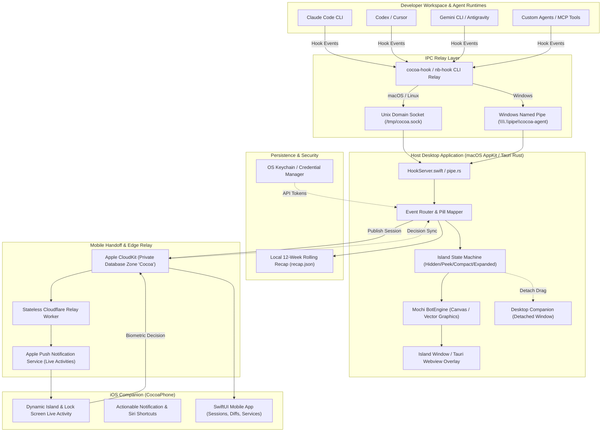
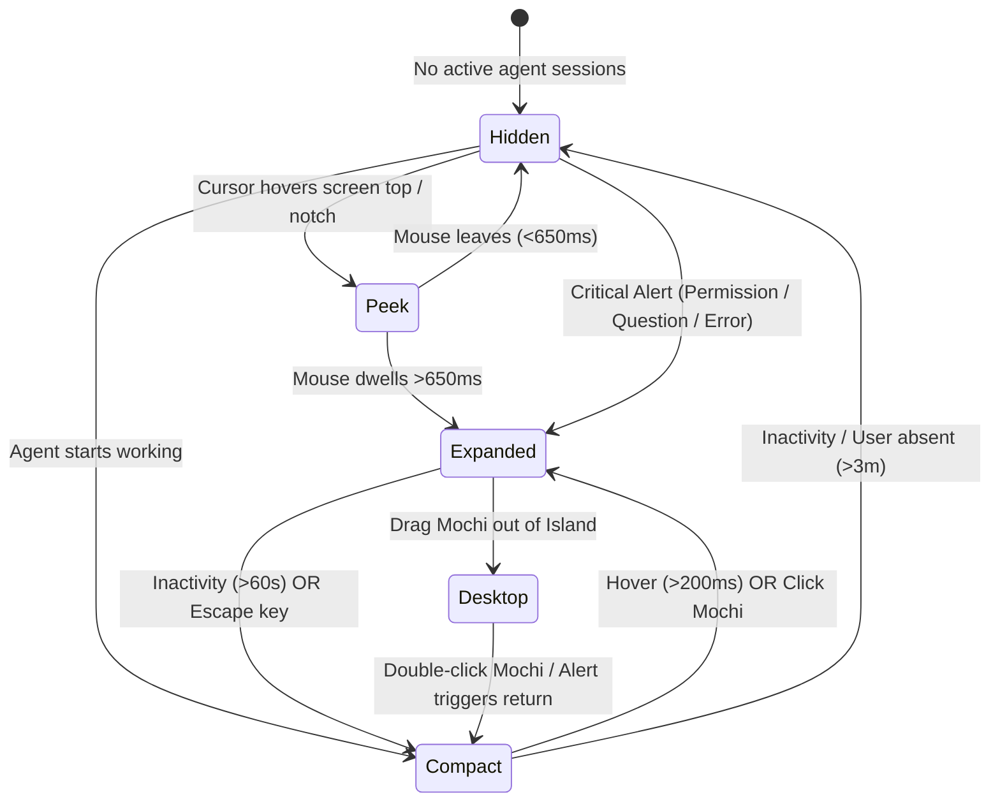
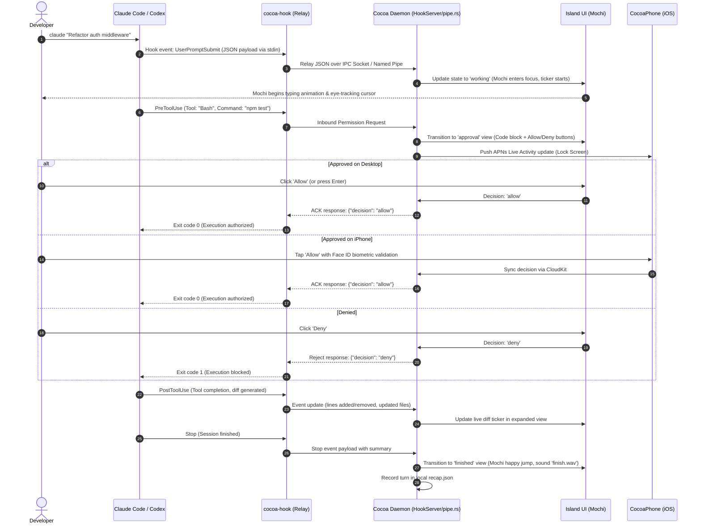
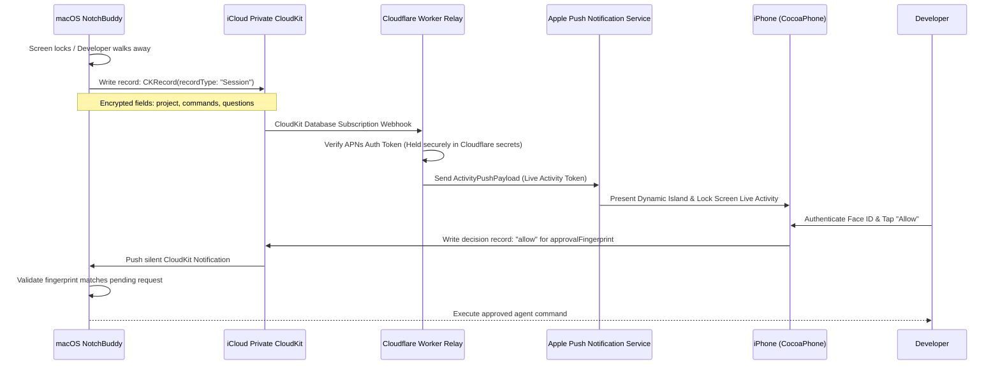
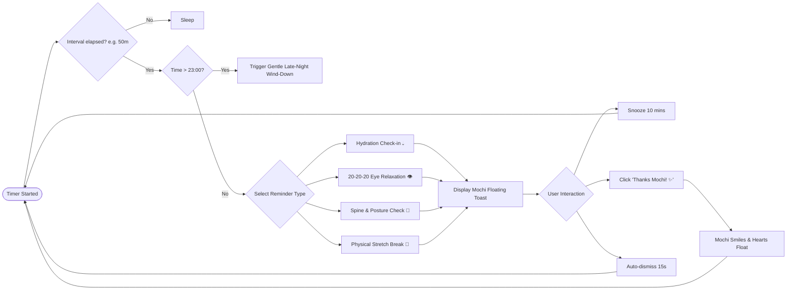

# Cocoa Notch — Application Flow & State Lifecycles

## 1. Executive Summary & Purpose

**Cocoa Notch** (known natively as `NotchBuddy` on macOS, Cocoa for Windows/Linux on Tauri 2, and `CocoaPhone` on iOS) is an ambient developer companion and AI coding agent orchestrator. It sits within the hardware display notch on modern MacBooks, at the screen top bar on external displays and Windows/Linux desktops, and synchronizes to the iOS Dynamic Island and Lock Screen.

This document outlines the end-to-end operational flows, user interaction paradigms, state machines, IPC pipelines, cross-device synchronization loops, and lifecycle transitions across all supported platforms.

---

## 2. High-Level System Flow Diagram

---

## 3. Island Display States & Geometry

The island interface adheres to strict dimensions and geometric constraints depending on the host hardware (presence of a physical MacBook display notch vs. flat displays):

### 3.1 Island Geometric Specifications

| Mode | Width (macOS Notch) | Height (macOS Notch) | Width (Windows / No Notch) | Height (Windows / No Notch) | Mochi Diameter | Sub-Agent Grid |
| :--- | :--- | :--- | :--- | :--- | :--- | :--- |
| **`hidden`** | $wN$ (physical notch width, ~184pt) | $hN$ (safe area top, ~32pt) | 80pt | 24pt | Hidden ($0\text{pt}$) | Inactive |
| **`peek`** | $wN + 64\text{pt}$ | $hN$ | 148pt | 24pt | $\varnothing 18\text{pt}$ | Inactive |
| **`compact`** | $wN + 104\text{pt}$ | $hN$ | 240pt | 24pt | $\varnothing 20\text{pt}$ | $2 \times 2$ mini-bot matrix |
| **`expanded`** | $640\text{pt}$ | Dynamic ($136\text{pt} - 320\text{pt}$) | $640\text{pt}$ | Dynamic ($136\text{pt} - 320\text{pt}$) | $\varnothing 44\text{pt} - 70\text{pt}$ | Vertical right-hand column |

### 3.2 Inactivity & Dismissal Rules
1. **Zero-Work Idle**: If no agents are actively running and no alerts are pending, the island retracts to `hidden` mode. In this mode, background CPU consumption is strictly **0.0%**.
2. **Auto-Dismiss Countdown**: In `expanded` mode with no active user input, a 60-second timer initiates. During the final 10 seconds, a visual $2\text{pt}$ white progress bar (shrinking from $160\text{pt}$ to $0\text{pt}$) signals imminent retraction.
3. **Absence Detection**: Polling mouse movement via `NSEvent.mouseLocation` (macOS) or Windows cursor hooks; if inactive for 3 minutes (configurable), the island transitions from `compact` to `hidden` until cursor movement resumes.
4. **Alert Override**: Any inbound permission request (`approval`), interactive selection (`question`), or execution failure (`error`) forcefully opens the island regardless of absence, remaining open until the developer responds.

---

## 4. Agent Interception & Hook Lifecycle

Cocoa acts as an external observability and approval hook. The lifecycle begins when a supported AI CLI or IDE extension triggers an event.

---

## 5. View Hierarchies & Expansion States

When in `expanded` mode ($640\text{pt}$ width), Cocoa dynamically adjusts its card height and layout based on the active event context:

```mermaid
classDiagram
    class IslandExpandedView {
        +Header (34pt: Tabs, Active Count, Sound Toggle)
        +LeftCard (Focused Agent Details)
        +RightCard / RightColumn (Sub-agents or Service Details)
    }

    class OverviewView {
        +Height: 196pt
        +LeftCard: Agent status + Animated 4-line Ticker
        +RightCard: Active pill matrix & service badges
    }

    class ApprovalView {
        +Height: 206pt
        +Command snippet block
        +Action buttons: Allow (Y), Always Allow, Deny (N)
    }

    class QuestionView {
        +Height: 196pt
        +Question title (1/N)
        +Choice buttons (Single/Multi-select)
        +Custom input trigger ('Other...')
        +Fallback: 'Reply in terminal'
    }

    class ErrorView {
        +Height: 190pt
        +Error badge (#FF8D97)
        +Stack trace / Reason snippet
        +Retry / Open in external debugger
    }

    class FinishedView {
        +Height: 170pt
        +Turn summary & execution metrics
        +Terminal link button
        +Dismiss button (Auto-closes in 5.2s)
    }

    class ChatView {
        +Height: 156pt - 320pt
        +Context pill + Model selector
        +Markdown streaming response
        +Microphone dictation button
    }

    class FileDropView {
        +Height: 176pt
        +Mochi 'swallow box' animation
        +Actions: Ask Claude / Send via Email
    }

    IslandExpandedView <|-- OverviewView
    IslandExpandedView <|-- ApprovalView
    IslandExpandedView <|-- QuestionView
    IslandExpandedView <|-- ErrorView
    IslandExpandedView <|-- FinishedView
    IslandExpandedView <|-- ChatView
    IslandExpandedView <|-- FileDropView
```

---

## 6. Desktop Mochi Detachment Physics

Developers can detach Mochi from the notch to float as an interactive desktop companion:

1. **Drag Initiation**: Dragging Mochi beyond a $40\text{pt}$ downward threshold from the notch detaches the view.
2. **Window Transition**: The main island panel creates a dedicated transparent borderless window (`DesktopMochi.swift` / `desktop.rs`) sized at $120\text{pt} \times 120\text{pt}$.
3. **Cursor Tracking & Physics**:
   - Mochi's eyes follow the global pointer using spherical coordinate math.
   - Idling displays gentle vertical breathing oscillation ($0.05\text{Hz}$).
   - Three consecutive rapid clicks trigger the "dizzy" animation state with spinning spiral eyes.
   - Hovering for $>2$ seconds triggers heart float particles.
4. **Docking & Recall**:
   - Double-clicking Mochi triggers a smooth spring fly-back animation to the notch.
   - Any high-priority alert (Permission, Question, Error) automatically recalls Mochi to the notch header.

---

## 7. Cross-Device CloudKit & Live Activity Sync

---

## 8. Developer Welfare & Wellness Workflow

Cocoa integrates proactive health monitoring to mitigate developer fatigue:

---

## 9. Error Recovery & Fail-Safe Mechanics

| Failure Mode | Impact | Automatic Mitigation & Fallback |
| :--- | :--- | :--- |
| **Daemon Crash / Disconnect** | Hook cannot deliver payload | `cocoa-hook` sets a strict $200\text{ms}$ timeout. If Cocoa does not acknowledge, the hook exits cleanly (`code 0`), allowing CLI agents to operate without blocking. |
| **Corrupted Config (`settings.json`)** | Invalid user settings | Settings parser strictly validates JSON. Before writing, a dated timestamped backup (`settings.json.bak.<timestamp>`) is created. If parsing fails, defaults apply. |
| **CloudKit Sync Network Offline** | Mobile handoff delayed | Local decisions take priority. If no iPhone response occurs within $30\text{s}$, the desktop UI displays a prompt to decide locally. |
| **Multiple Simultaneous Alerts** | Alert collision | FIFO Alert Queue: Only one interactive alert modal renders at a time. Secondary alerts queue in the right-hand mini-bot column. |
