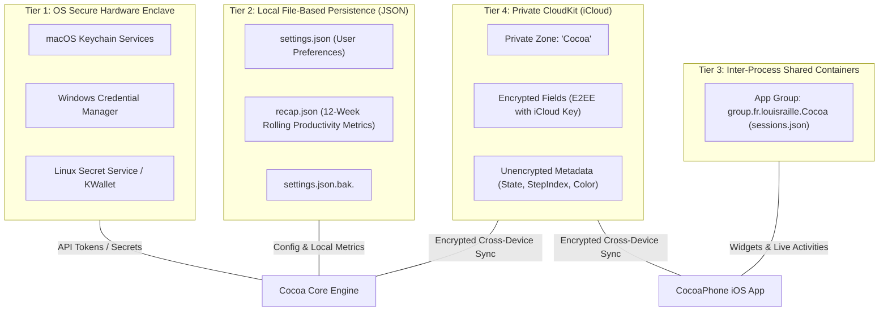
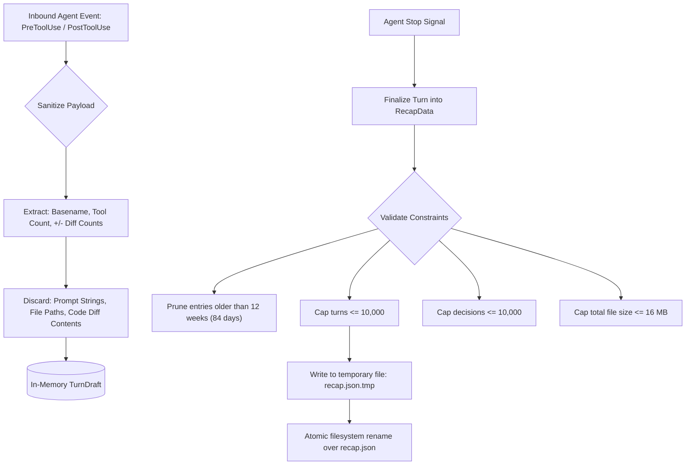
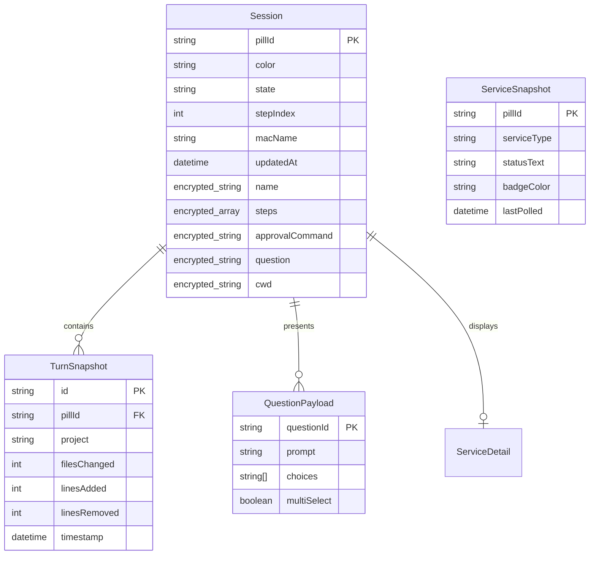

# Cocoa Notch — Data Storage, Persistence & Schema Specification

## 1. Storage Architecture & Privacy Manifesto

Cocoa Notch is designed under a strict **Zero-Telemetry, Local-First, Privacy-by-Design** philosophy:

```
┌────────────────────────────────────────────────────────────────────────┐
│                        COCOA PRIVACY GUARANTEE                         │
├────────────────────────────────────────────────────────────────────────┤
│ 1. Zero Cloud Telemetry: No analytics, tracking, or crash pings.       │
│ 2. Zero Code/Prompt Ingestion: Code contents, bash scripts, and diffs  │
│    are held in ephemeral memory only and NEVER written to recap logs.  │
│ 3. Secrets in Hardware Enclaves: API keys reside exclusively in the OS │
│    Keychain / Credential Manager; never saved in plain JSON or git.    │
│ 4. End-to-End Encrypted CloudKit: Mobile handoff synchronizes solely   │
│    through the user's private iCloud container with encrypted values.  │
│ 5. Atomic Safe Writes: Any mutation to external configs (Claude Code)  │
│    generates a timestamped backup before committing atomic renames.    │
└────────────────────────────────────────────────────────────────────────┘
```

---

## 2. Multi-Tier Data Storage Architecture



---

## 3. Tier 1: Hardware & OS Secure Enclave (Keyring)

API keys and service authentication credentials are store-isolated via native OS credential providers using the service identifier `com.rohit.cocoa` (with backward-compatible migration fallback to legacy `fr.louisraille.coucou`).

### 3.1 Allowed Key Registry (`KNOWN_KEYS`)

| Key Name | Purpose | Target Provider / API |
| :--- | :--- | :--- |
| `anthropic-api-key` | In-notch Claude chat and direct queries | Anthropic API (`api.anthropic.com`) |
| `openai-api-key` | In-notch OpenAI models (GPT-4o, o3-mini) | OpenAI API (`api.openai.com`) |
| `google-api-key` | Gemini CLI and in-notch Gemini chat | Google Generative AI |
| `openrouter-api-key` | OpenRouter model proxy routing | OpenRouter API |
| `openai-compatible-key` | Local LLMs (Ollama, LM Studio, vLLM) | Custom base URL endpoints |
| `github-token` | Pulse polling (PRs, reviews, CI status) | GitHub GraphQL / REST v3 |
| `vercel-token` | Deployment monitoring and redeploy triggers | Vercel API v6 |
| `stripe-api-key` | Daily/weekly revenue and balance tracking | Stripe API (`api.stripe.com`) |
| `resend-api-key` | Transactional email status & metrics | Resend API v1 |
| `notion-api-key` | Workspace action counters & mentions | Notion API v1 |
| `calcom-api-key` | Meeting countdowns and event links | Cal.com API v2 |
| `gcal-url` | Private iCal calendar feed URL | Google Calendar ICS endpoint |
| `n8n-url` / `n8n-api-key` | Workflow status & webhook execution | Self-hosted n8n instances |

*Security Rule:* Calling the keyring with any key identifier not explicitly present in `KNOWN_KEYS` triggers an immediate runtime rejection.

---

## 4. Tier 2: Local Rolling Store (`recap.json`)

The Weekly Productivity Recap engine tracks session counts, lines changed, and decision metrics across a rolling 12-week window.

### 4.1 Storage Paths
- **macOS**: `~/Library/Application Support/NotchBuddy/recap.json`
- **Windows**: `%LOCALAPPDATA%\Cocoa\recap.json` (or `%LOCALAPPDATA%\Coucou\recap.json`)
- **Linux**: `~/.local/share/cocoa/recap.json`

### 4.2 JSON Schema & Data Structure

```json
{
  "$schema": "http://json-schema.org/draft-07/schema#",
  "title": "RecapData",
  "type": "object",
  "required": ["turns", "decisions", "schemaVersion"],
  "properties": {
    "schemaVersion": {
      "type": "integer",
      "enum": [1]
    },
    "turns": {
      "type": "array",
      "items": { "$ref": "#/definitions/RecapTurn" }
    },
    "decisions": {
      "type": "array",
      "items": { "$ref": "#/definitions/RecapDecision" }
    }
  },
  "definitions": {
    "RecapTurn": {
      "type": "object",
      "required": ["pillId", "project", "start", "end", "filesChanged", "linesAdded", "linesRemoved", "commandsRun", "questions"],
      "properties": {
        "pillId": { "type": "string", "maxLength": 64 },
        "project": { "type": "string", "maxLength": 64, "description": "Last component of workspace path only, e.g., 'Cocoa Notch'" },
        "start": { "type": "string", "format": "date-time" },
        "end": { "type": "string", "format": "date-time" },
        "filesChanged": { "type": "integer", "minimum": 0 },
        "linesAdded": { "type": "integer", "minimum": 0 },
        "linesRemoved": { "type": "integer", "minimum": 0 },
        "commandsRun": { "type": "integer", "minimum": 0 },
        "questions": { "type": "integer", "minimum": 0 }
      }
    },
    "RecapDecision": {
      "type": "object",
      "required": ["pillId", "date", "decision"],
      "properties": {
        "pillId": { "type": "string", "maxLength": 64 },
        "date": { "type": "string", "format": "date-time" },
        "decision": {
          "type": "string",
          "enum": ["allow", "always", "deny", "ask"]
        }
      }
    }
  }
}
```

### 4.3 Retention Limits & Sanitization Bounds



---

## 5. Tier 3: Application Configuration Schema (`settings.json`)

User configurations are serialized as plain JSON in `%LOCALAPPDATA%\Cocoa\settings.json` (Windows), `~/.config/cocoa/settings.json` (Linux), or stored via `UserDefaults` keys under `fr.louisraille.NotchBuddy` (macOS).

### 5.1 Field Definitions & Defaults

```typescript
interface CocoaSettings {
  // Sound & Audio
  soundEnabled: boolean;                // Default: true
  soundVolume: number;                  // Default: 0.8 (0.0 - 1.0)

  // Interaction Timers
  autoCloseInterval: number;            // Default: 60.0 (seconds before auto-retract)
  absenceInterval: number;              // Default: 180.0 (seconds before idle hidden)
  idleAutoHide: boolean;                // Default: true
  idleHideInterval: number;             // Default: 10.0 (seconds)

  // Display & UI Anchoring
  screen: "primary" | "cursor" | string;// Display selector: "primary", "cursor", or UUID
  openOnHover: boolean;                 // Default: true
  mainPill: string;                     // Default: "workspace_cursor" or "agent_claude"
  activeIntegrations: string[];         // Max 5 toggled active pills

  // Agent & Model Configurations
  model: string;                        // Default: "claude-3-7-sonnet-latest"
  hooksInstalled: boolean;              // Automatic hook setup status
  showPlanInNotch: boolean;             // Claude 5h/weekly usage pill in notch
  planRelayInstalled: boolean;          // Claude Code status line relay
  showCodexPlanInNotch: boolean;        // Codex CLI plan meter

  // System Hardware Stats
  showSystemStats: boolean;             // Default: false
  showCpuUsage: boolean;                // Default: true (when stats active)
  showGpuUsage: boolean;                // Default: true
  showRamUsage: boolean;                // Default: true
  showGpuTemp: boolean;                 // Default: false

  // Developer Welfare & Wellness
  welfareReminders: boolean;            // Default: true
  welfareIntervalMinutes: number;       // Default: 50.0 minutes
  welfareBreakReminders: boolean;       // Default: true
  welfareHydrationReminders: boolean;   // Default: true
  welfareNightOwlAlerts: boolean;       // Default: true (alerts after 23:00)
  welfarePostureReminders: boolean;     // Default: true (20-20-20 rule)

  // Advanced UI Features
  enableHeroPillCard: boolean;          // High-prominence card when single pill active
  enableLiveDiffs: boolean;             // Direct inline diff inspector on file modify
}
```

---

## 6. Tier 4: CloudKit Entity Schema (`Cocoa` Zone)

For iPhone synchronization via private CloudKit databases (`iCloud.fr.louisraille.Cocoa`), record types are partitioned into encrypted payloads and unencrypted metadata:



### 6.1 Field Encryption Matrix

| Record Type | Unencrypted Fields (Indexed for Querying) | Encrypted Fields (`encryptedValues`) |
| :--- | :--- | :--- |
| **`Session`** | `pillId`, `color`, `state`, `stepIndex`, `needsApproval`, `approvalFingerprint`, `acceptsInstructions`, `questionFingerprint`, `updatedAt`, `macName` | `name` (Project title), `steps` (Command history), `approvalCommand` (Shell string), `question` (Agent query), `questionPayload` (Options JSON), `finalLine`, `cwd` (Working directory) |
| **`Ping`** | `macName`, `app`, `sentAt` | `message` |
| **`ServiceSnapshot`** | `pillId`, `category`, `tone`, `urgency`, `updatedAt` | `detailText`, `accountName`, `metricsJSON` |

---

## 7. Tier 5: App Group Shared Container (`group.fr.louisraille.Cocoa`)

On iOS, the main app shares real-time session state with the `CocoaWidgets` extension (Dynamic Island, Lock Screen, and Home Screen widgets) via a sandboxed App Group container file: `sessions.json`.

```json
[
  {
    "id": "agent_claude",
    "title": "Cocoa Notch",
    "agent": "Claude Code",
    "color": "#D97706",
    "state": "working",
    "statusText": "running tests · 4/7",
    "tone": "working",
    "urgency": 1,
    "stepIndex": 4,
    "stepCount": 7,
    "currentStep": "Bash npm test",
    "updatedAt": "2026-10-14T20:45:00Z"
  }
]
```

---

## 8. Data Migration & Compatibility Protocols

1. **Forward Compatibility**: In both Swift (`Decodable`) and Rust (`serde`), missing JSON keys take values from default initializers (`#[serde(default)]`), ensuring older configurations load seamlessly when updated.
2. **Schema Versioning**: Every persistent document (`recap.json`, `settings.json`) maintains a top-level `schemaVersion: 1` property.
3. **Graceful Degradation**: If an encrypted CloudKit field fails decryption due to an incomplete iCloud key sync, the iPhone app renders an obfuscated placeholder (`"Session waiting for authorization"`) rather than terminating.
