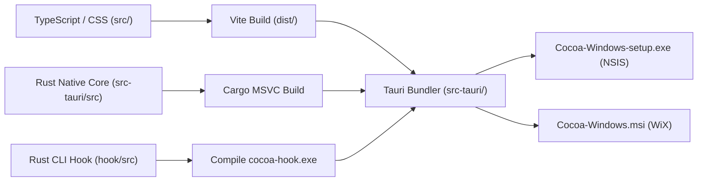
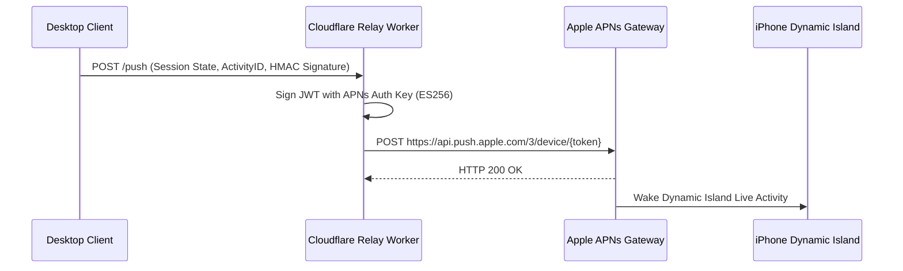

# Cocoa Notch — Deployment, Build & Distribution Guide

## 1. Overview & Multi-Platform Matrix

Cocoa Notch is engineered across multiple target ecosystems using native toolchains tailored to each operating environment:

| Platform | Target Artifacts | Framework / Architecture | Distribution Channel |
| :--- | :--- | :--- | :--- |
| **macOS** (15+ Sequoia) | Universal Binary (`arm64`, `x86_64`), `.dmg`, `.zip` | Swift 6, AppKit + SwiftUI, XcodeGen | GitHub Releases, Mac App Store |
| **Windows** (10 / 11) | NSIS (`Cocoa-Windows-setup.exe`), MSI (`Cocoa-Windows.msi`), Portable `.exe` | Tauri 2 (Rust core + WebView2 + TypeScript) | GitHub Releases, Direct Download |
| **Linux** (x86_64) | AppImage, Debian (`.deb`), RedHat (`.rpm`) | Tauri 2 (Rust core + WebKitGTK 4.1) | GitHub Releases |
| **iOS** (18+) | `.ipa` (App + Widgets + Notification Extensions) | Swift 6, SwiftUI, Dynamic Island, CloudKit | Apple TestFlight, App Store |
| **Relay Edge** | Cloudflare Worker (`stateless-relay.js`) | Node.js, TypeScript, Cloudflare Wrangler | Cloudflare Edge Network |

---

## 2. Toolchain Prerequisites

### 2.1 macOS Toolchain
- **Operating System**: macOS 15.0 (Sequoia) or later
- **Xcode**: Xcode 16.0+ with Command Line Tools
- **XcodeGen**: `brew install xcodegen`
- **Swift**: Swift 6.0 toolchain (bundled with Xcode 16)
- **Apple Developer Account**: Required for CloudKit entitlement and Apple Notarization

### 2.2 Windows Toolchain
- **Operating System**: Windows 10 (64-bit Build 19041+) or Windows 11
- **Visual Studio**: Visual Studio 2022 Community/Professional with **Desktop development with C++** workload
- **Rust**: Rust 1.80+ (`stable-x86_64-pc-windows-msvc`)
- **Node.js**: Node.js 20+ LTS & npm
- **Tauri CLI**: Bundled in `windows/package.json` (`@tauri-apps/cli`)
- **WebView2 Runtime**: Evergreen Bootstrapper (pre-installed on Windows 10/11)

### 2.3 Linux Toolchain
- **Debian/Ubuntu Packages**:
  ```bash
  sudo apt-get update && sudo apt-get install -y \
    build-essential curl wget libssl-dev libgtk-3-dev \
    libwebkit2gtk-4.1-dev libappindicator3-dev librsvg2-dev patchelf
  ```
- **Fedora Packages**:
  ```bash
  sudo dnf install -y \
    gcc gcc-c++ openssl-devel gtk3-devel webkit2gtk4.1-devel \
    libappindicator-gtk3-devel librsvg2-devel patchelf
  ```

---

## 3. macOS Build & Packaging (`NotchBuddy`)

The macOS project is generated declaratively with XcodeGen via `NotchBuddy/project.yml`. Never edit `NotchBuddy.xcodeproj` directly.

### 3.1 Local Debug Build
```bash
cd NotchBuddy
xcodegen generate
xcodebuild -scheme NotchBuddy -configuration Debug -destination 'platform=macOS' build
```

### 3.2 Production Release Build & DMG Packaging
```bash
cd NotchBuddy
xcodegen generate
xcodebuild -scheme NotchBuddy -configuration Release -archivePath build/NotchBuddy.xcarchive archive

# Export application bundle
xcodebuild -exportArchive \
  -archivePath build/NotchBuddy.xcarchive \
  -exportPath build/Release \
  -exportOptionsPlist exportOptions.plist

# Package into DMG
hdiutil create -volname "Cocoa" -srcfolder build/Release/Cocoa.app -ov -format UDZO build/Cocoa-macOS.dmg
```

### 3.3 Apple Notarization Protocol
For standalone DMG distribution outside the Mac App Store:
```bash
# Code sign with Developer ID Application
codesign --force --deep --options runtime \
  --sign "Developer ID Application: Your Name (TEAM_ID)" \
  --entitlements NotchBuddy/NotchBuddy.entitlements \
  build/Release/Cocoa.app

# Submit for Apple Notarization
xcrun notarytool submit build/Cocoa-macOS.dmg \
  --keychain-profile "AC_NOTARY_PROFILE" \
  --wait

# Staple notarization ticket
xcrun stapler staple build/Cocoa-macOS.dmg
```

---

## 4. Windows Build & Packaging (Tauri 2)

The Windows desktop client is built using Tauri 2 with a Rust backend and web frontend.



### 4.1 Step-by-Step Build Commands
```powershell
# Navigate to windows workspace
cd windows

# Install frontend dependencies
npm install

# Compile the standalone CLI hook
cargo build --release --manifest-path hook/Cargo.toml
cp hook/target/release/cocoa-hook.exe ../cocoa-hook.exe

# Build the complete production application bundle
npm run tauri build
```

Production artifacts are output to `windows/src-tauri/target/release/bundle/`:
- `nsis/Cocoa-Windows-setup.exe` (User installer, no admin prompt required)
- `msi/Cocoa-Windows.msi` (Machine-wide installer)

### 4.2 Windows SmartScreen & Antivirus Mitigation
Because self-signed or new binaries lack initial Microsoft SmartScreen reputation:
1. **User Guidance**: First-time users click *More Info* $\rightarrow$ *Run anyway*.
2. **Defender False-Positive Clearing**: If Microsoft Defender triggers a machine-learning heuristic (`Trojan:Win32/Wacatac.H!ml`), update signatures immediately:
   ```powershell
   Update-MpSignature
   ```
3. **Official Signing**: For enterprise or commercial releases, sign the binary using an EV Code Signing Certificate:
   ```powershell
   signtool sign /fd SHA256 /a /tr http://timestamp.digicert.com /td SHA256 "windows/src-tauri/target/release/bundle/nsis/Cocoa-Windows-setup.exe"
   ```

---

## 5. Linux Build & Packaging

Build universal Linux binaries across AppImage, DEB, and RPM targets:

```bash
cd windows
npm install
npm run tauri build -- --bundles appimage,deb,rpm
```

The resulting packages:
- `target/release/bundle/appimage/Cocoa_amd64.AppImage`
- `target/release/bundle/deb/cocoa_amd64.deb`
- `target/release/bundle/rpm/cocoa.x86_64.rpm`

---

## 6. iOS CocoaPhone & Dynamic Island Deployment

The iOS client (`NotchBuddy/Sources/Phone`) requires Xcode 16 and valid Apple Developer credentials with CloudKit and Push Notification entitlements.

### 6.1 Scheme Targets
- `CocoaPhone`: Main iOS SwiftUI application
- `CocoaWidgets`: WidgetKit extension (Dynamic Island & Lock Screen Live Activities)
- `CocoaNotificationContent`: Custom expanded approval banner

### 6.2 TestFlight & App Store Build
```bash
cd NotchBuddy
xcodegen generate
xcodebuild -scheme CocoaPhone -configuration Release \
  -destination 'generic/platform=iOS' \
  -archivePath build/CocoaPhone.xcarchive archive

xcodebuild -exportArchive \
  -archivePath build/CocoaPhone.xcarchive \
  -exportPath build/iOSRelease \
  -exportOptionsPlist phoneExportOptions.plist

# Upload to App Store Connect / TestFlight
xcrun altool --upload-app -f build/iOSRelease/CocoaPhone.ipa -t ios --apiKey "$API_KEY" --apiIssuer "$ISSUER_ID"
```

---

## 7. Cloudflare Relay Deployment (`relay/`)

The Cocoa Relay is a stateless Cloudflare Worker acting as a push gateway for iOS Live Activities without bundling private APNs keys in user-facing builds.



### 7.1 Deployment Commands
```bash
cd relay
npm install

# Authenticate Cloudflare credentials
npx wrangler login

# Configure Cloudflare Secrets
npx wrangler secret put APNS_KEY_ID
npx wrangler secret put APNS_TEAM_ID
npx wrangler secret put APNS_PRIVATE_KEY

# Deploy to Cloudflare Edge
npx wrangler deploy
```

---

## 8. Release Automation Script (`scripts/release.sh`)

Automated semantic releases are orchestrated via `scripts/release.sh`:

```bash
./scripts/release.sh 0.2.0
```

This automated sequence executes:
1. Validates working tree is clean.
2. Updates version in `NotchBuddy/project.yml`, `windows/package.json`, `windows/src-tauri/Cargo.toml`.
3. Runs unit and integration test suites (`scripts/test-*.sh`).
4. Generates CHANGELOG entries from commit messages.
5. Commits version bumps, creates Git tag `v0.2.0`, and pushes to GitHub.
6. Triggers GitHub Actions workflow to compile multi-platform binaries and create draft GitHub Release.
