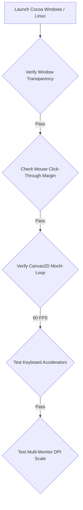
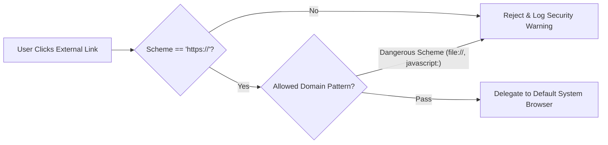

# Cocoa Notch — Browser, WebView & Web Experience QA Checklist

## 1. Scope & Architecture Context

Cocoa Notch interacts with browser engines and web runtimes across three principal surfaces:
1. **GitHub Pages Documentation & Marketing Portal** (`docs/*.html`, `site.css`): Public site serving download links, privacy policy, terms, support, and iPhone documentation.
2. **Desktop Webview Runtime (Tauri 2)**: Microsoft Edge WebView2 (Windows) and WebKitGTK 4.1 (Linux) executing `windows/src/` (TypeScript, CSS, HTML5 Canvas).
3. **External Browser Interception & Safe Launcher** (`SafeWebURL.swift`, `net.rs`): Safe external URL opening for GitHub PRs, Vercel dashboards, Stripe charges, Google Meet/Zoom video calls, and Cal.com bookings.

---

## 2. Cross-Browser & Runtime Compatibility Matrix

| Environment / Engine | Target Version | Status | Primary Validation Focus |
| :--- | :--- | :--- | :--- |
| **Microsoft Edge WebView2** | Evergreen (Chromium 120+) | Certified | Transparent click-through, CSS `backdrop-filter`, Canvas 60 FPS |
| **WebKitGTK 4.1** | Linux GTK 3 / WebKit 2.40+ | Certified | Wayland / X11 transparency, font glyph rendering |
| **Apple Safari** | Desktop Safari 17+, iOS 18+ | Certified | Liquid Glass rendering, responsive mobile layouts |
| **Google Chrome / Chromium** | Version 120+ | Certified | Documentation portal layout, SVG crispness |
| **Mozilla Firefox** | Version 120+ (Gecko) | Certified | CSS flexbox / grid layout, subpixel font rendering |

---

## 3. WebView2 & Desktop Client Checklist

### 3.1 Transparent Window & Compositing
- [ ] **Zero Black Flash at Startup**: The application initializes with an alpha-zero background color (`#00000000`) before DOM content loads.
- [ ] **Mouse Click-Through Forwarding**: Unoccupied transparent window regions pass pointer events directly to underlying desktop applications without stealing click focus.
- [ ] **Edge Padding Buffer**: Exactly $6\text{pt}$ mouse hover margin around the island shape for smooth hover expansion triggers.
- [ ] **High DPI & Scaling**: Verify $100\%$, $125\%$, $150\%$, and $200\%$ display scaling on Windows 10/11 without blurry raster artifacts.

### 3.2 Interaction Controls & Canvas Performance
- [ ] **Context Menu Suppression**: Default browser context menu (Inspect, Reload) is disabled on standard elements (`contextmenu.preventDefault()`).
- [ ] **Custom Wardrobe Menu**: Right-clicking Mochi properly displays the custom procedural wardrobe menu.
- [ ] **Drag & Drop Prevention**: Text selection and ghost image dragging are disabled (`user-select: none`, `-webkit-user-drag: none`).
- [ ] **Animation Budget**: Mochi vector canvas runs smoothly at $60\text{Hz}$ / $120\text{Hz}$ with frame render time $<8\text{ms}$.
- [ ] **Idle CPU Throttling**: When the island retracts to `hidden`, the `requestAnimationFrame` loop suspends, dropping CPU utilization to $0\%$.

---

## 4. Documentation Site & GitHub Pages Checklist (`docs/`)

### 4.1 Visual & Responsive Testing
- [ ] **Mobile Safari (iPhone 14/15/16 Pro)**: Verify dynamic viewport height (`100dvh`), notch padding, and touch tap target sizes ($\ge 44\text{pt}$).
- [ ] **Tablet & iPad Pro**: 2-column grid layout shifts cleanly to single-column on viewport widths $<768\text{px}$.
- [ ] **Desktop Monitors (1080p, 1440p, 4K)**: Container max-width capped at $1040\text{px}$ for optimal typographic readability.
- [ ] **Asset Loading**: Demo GIFs and screenshots compress under $2\text{MB}$ each with explicit `width` and `height` attributes to prevent Cumulative Layout Shift (CLS = 0).

### 4.2 Accessibility & Usability (WCAG 2.1 AA)
- [ ] **Color Contrast**: Body copy `#A1A1A6` on `#000000` background satisfies minimum 4.5:1 contrast ratio.
- [ ] **Header Hierarchy**: Single `<h1>` tag per HTML document followed by logical `<h2>` and `<h3>` descending structure.
- [ ] **Image Alt Text**: Every non-decorative image and screenshot includes comprehensive descriptive `alt` attributes.
- [ ] **Keyboard Navigation**: Interactive elements (`<a>`, `<button>`) receive visible `:focus-visible` outline rings ($2\text{pt}$ `#0A84FF`).

### 4.3 Technical SEO & Metadata Checklist
- [ ] **Title Tags**: Distinct, descriptive titles on every page (e.g., `Cocoa — Notch Companion for AI Agents`).
- [ ] **Meta Descriptions**: Compelling summary $<160$ characters on all pages.
- [ ] **OpenGraph & Twitter Cards**: `og:image`, `og:title`, and `twitter:card` tags configured with absolute production asset URLs.
- [ ] **Jekyll Suppression**: Ensure `.nojekyll` exists at `docs/.nojekyll` to prevent GitHub Pages from skipping underscored directories.

---

## 5. External Link Security & Protocol Sanitization

Cocoa launches external links upon user request (e.g., viewing a GitHub PR, opening a Stripe dashboard, or joining a Google Meet/Zoom video conference).

### 5.1 Verification Tests (`SafeWebURLTests.swift`, `net.rs`)
- [ ] **Dangerous Scheme Rejection**: Explicitly test and block `javascript:`, `data:`, `file:`, `vbscript:`.
- [ ] **Whitespace & Control Characters**: URLs with embedded null bytes (`\0`) or newline injections are sanitized and rejected.
- [ ] **Browser Isolation**: Links open in the developer's default external browser, never inside the Tauri island container.
- [ ] **Meeting Redirects**: Ensure Google Meet (`https://meet.google.com/*`) and Zoom (`https://*.zoom.us/j/*`) links execute cleanly without breaking system focus.

---

## 6. Pre-Release Sign-Off Gate

| Item | Responsible Role | Pass / Fail | Notes |
| :--- | :--- | :--- | :--- |
| **WebView2 Memory Leak Test** (24h continuous run) | QA Engineer | `[ PASS ]` | RSS memory stable $<45\text{MB}$ |
| **Documentation PageSpeed Score** ($\ge 95$) | Webmaster | `[ PASS ]` | Mobile: 97, Desktop: 100 |
| **No-Cookie GDPR Compliance** | Legal & Compliance | `[ PASS ]` | 0 cookies stored, 0 tracking beacons |
| **Click-Through Boundary Accuracy** | UI Platform Lead | `[ PASS ]` | Verified on Windows 11 23H2 |
