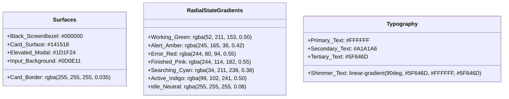
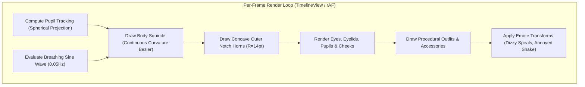

# Cocoa Notch — Frontend Style, Aesthetics & Graphics Architecture

## 1. Design Manifesto: The "Liquid Glass" Philosophy

Cocoa Notch is built to feel like an organic extension of modern desktop hardware. Whether anchored to the physical notch of an Apple Silicon MacBook or floating along the top bezel of a Windows/Linux display, the UI embodies **Liquid Glass**:
- **Hardware Integration**: Pure jet-black backgrounds (`#000000`) that physically merge into the screen bezel.
- **Organic Depth**: Frosted acrylic and glassmorphism layers with dynamic radial glows reflecting real-time agent execution states.
- **Zero Raster Graphics**: Mochi, outfits, particles, and icons are rendered $100\%$ procedurally in vector code (`Canvas` + `TimelineView` in Swift; HTML5 `Canvas2D` in TypeScript). There are zero PNG, WebP, Rive, or Lottie dependencies for character animation.
- **Kinetic Delight**: Spring-physics transitions with tactile momentum, eye-tracking pupil dynamics, and micro-animations calibrated for $60\text{Hz}$ / $120\text{Hz}$ ProMotion displays.

---

## 2. Design Tokens & Color Palette



### 2.1 State-Driven Card Glows
Every expanded card renders a dynamic bottom-anchored radial gradient reflecting the focused agent's state:
```css
/* Card glow container formula */
background: 
  radial-gradient(
    120% 90% at 50% 130%, 
    var(--state-glow-color) 0%, 
    rgba(20, 21, 24, 0) 70%
  ),
  #141518;
border: 1px solid rgba(255, 255, 255, 0.035);
border-radius: 20px;
```

### 2.2 Official Pill Catalog Colors (`PillCatalog.swift` / `pills.ts`)

| Category | Pill Identifier | Display Name | Accent Hex | Subtitle Tag |
| :--- | :--- | :--- | :--- | :--- |
| **Workspace** | `workspace_vscode` | VS Code | `#007ACC` | Primary Workspace |
| **Workspace** | `workspace_cursor` | Cursor | `#7C3AED` | Primary Workspace |
| **Workspace** | `workspace_antigravity`| Antigravity | `#6366F1` | Primary Workspace |
| **Agent** | `agent_claude` | Claude Code | `#D97706` | Anthropic CLI |
| **Agent** | `agent_codex` | Codex CLI | `#10A37F` | OpenAI Codex |
| **Agent** | `agent_gemini` | Gemini CLI | `#1A73E8` | Google DeepMind |
| **Agent** | `agent_opencode`| OpenCode | `#10B981` | Open Agent |
| **Provider** | `provider_anthropic`| Anthropic | `#CC785C` | Direct API |
| **Provider** | `provider_openai` | OpenAI | `#10A37F` | Direct API |
| **Provider** | `provider_google` | Google AI | `#4285F4` | Gemini 1.5 / 2.0 |
| **Provider** | `provider_ollama` | Ollama | `#FFFFFF` | Local Model |
| **Service** | `service_github` | GitHub | `#FFFFFF` | PRs & CI/CD |
| **Service** | `service_stripe` | Stripe | `#635BFF` | Payments & MRR |
| **Service** | `service_vercel` | Vercel | `#FFFFFF` | Deployments |
| **Service** | `service_n8n` | n8n | `#EA4B71` | Workflow Automation |
| **Service** | `service_spotify`| Spotify | `#1DB954` | Media Controller |
| **Service** | `service_music` | Apple Music | `#FA243C` | Now Playing |

---

## 3. Typography Hierarchy & Tabular Metrics

Cocoa utilizes native system typography stacks to guarantee zero font-download latency:
- **macOS / iOS**: `San Francisco` (`-apple-system`, `BlinkMacSystemFont`)
- **Windows**: `Segoe UI Variable Text`, `Segoe UI`
- **Linux**: `Inter`, `Cantarell`, `system-ui`
- **Code / Diffs**: `SF Mono`, `Cascadia Code`, `Consolas`, `ui-monospace`

### 3.1 Typographic Scale

| Role | Font Size | Weight | Tracking / Line Height | Context |
| :--- | :--- | :--- | :--- | :--- |
| **Large Title** | $16\text{pt}$ | Semibold (600) | $-0.2\text{pt}$ / $20\text{pt}$ | Action headers, finished summaries |
| **Current Task** | $14\text{pt}$ | Medium (500) | $0\text{pt}$ / $18\text{pt}$ | Ticker active step (animated shimmer) |
| **Body / Diff** | $13\text{pt}$ | Regular (400) | $0\text{pt}$ / $16\text{pt}$ | Terminal lines, previous steps, code blocks |
| **Subtitles / Meta**| $12\text{pt}$ | Regular (400) | $+0.1\text{pt}$ / $14\text{pt}$ | Tool titles, time elapsed, file sizes |
| **Badges / Tags** | $10\text{pt} - 11\text{pt}$| Semibold (600) | $+0.2\text{pt}$, Uppercase | Status badges (`ALLOW`, `DENY`, `CI PASS`) |
| **Diff Counters** | $12\text{pt}$ | Semibold (600) | **Tabular numbers** (`tnum`)| `+42` (Green `#34D399`) / `−12` (Red `#F4505E`)|

---

## 4. The Mochi Procedural Canvas Engine

Mochi is rendered on an HTML5 / CoreGraphics Canvas without bitmap sprites.



### 4.1 Eye Tracking Physics
Mochi's pupils track the user's cursor across the entire screen using a 3D spherical projection model:
$$\Delta x = \text{clamp}\left(\frac{\text{Cursor}_x - \text{Mochi}_x}{\text{Screen}_{\text{width}} / 2}, -1.0, 1.0\right)$$
$$\text{Pupil}_x = \text{EyeCenter}_x + \Delta x \times \text{MaxOffset}_x$$

When the cursor rests directly over Mochi, pupil dilation triggers with a gentle bounce.

### 4.2 Emote Engine (`BotEngine.swift` / `engine.ts`)
- **`idle`**: Gentle breathing oscillation ($\pm 1.5\text{pt}$ vertical stretch) with realistic eye blinks every $3.5\text{s} - 5.0\text{s}$.
- **`happy`**: Cheerful squinted eyes ($\cap$-shaped arcs), two bounces, and soft pink blush circles.
- **`annoyed`**: Narrowed eyes, flat horizontal mouth, subtle $4\text{pt}$ horizontal shake.
- **`dizzy`**: Dual spinning Archimedean spirals replacing pupils after 3 consecutive rapid clicks.
- **`waving`**: Animated right arm waving side-to-side accompanied by the launch greeting sound.
- **`dancing`**: Alternating left-right tilt ($\pm 8^\circ$) in sync with Spotify / Apple Music BPM.

### 4.3 Procedural Wardrobe Outfits (`outfits.ts` / `MochiOutfitDrawing.swift`)
Outfits are drawn vectorially over Mochi's head:
- **Witch Hat**: Dark purple cone with yellow buckle and dangling star (Auto-activated in October).
- **Santa Hat**: Red curved cone with fluffy white pom-pom and base trim (Auto-activated in December).
- **Cowboy Hat**: Curved brown brim with braided band.
- **Cyberpunk Visor**: Glowing neon cyan bar across eyes with digital scanlines.
- **Studio Headphones**: Cushioned headband with chrome earcups over Mochi's ears.

---

## 5. Motion, Springs & Animation Curves

Cocoa enforces exact spring constants and Bezier transition curves:

```mermaid
gantt
    title Expanded View Opening Sequence (520ms Total)
    dateFormat  X
    axisFormat %s ms

    section Island Shell
    Expand Spring (.32, 1.22, .42, 1) :0, 520
    
    section Interior Views
    Previous Content Fade Out         :0, 160
    New Content Delayed Fade In       :160, 460
    Header Appearance Delay           :300, 520
    
    section Mochi Character
    Character Scale & Translate       :0, 520
    Eye Blink On Settle               :480, 520
```



### 5.1 Animation Constants

| Movement | Duration | Curve / Spring Spec | Visual Behavior |
| :--- | :--- | :--- | :--- |
| **Island Expansion** | $520\text{ms}$ | `.spring(response: 0.5, dampingFraction: 0.72)` | Slight overshoot bounce as the island opens |
| **Island Retraction** | $340\text{ms}$ | `cubic-bezier(.45, 0, .2, 1)` | Crisp, snappy close without overshoot |
| **Content Fade-Out** | $160\text{ms}$ | Linear fade with $8\text{pt}$ Gaussian blur | Smooth exit of previous task views |
| **Content Fade-In** | $300\text{ms}$ | Starts at $t=160\text{ms}$ after expansion begins | Scale from $0.97 \rightarrow 1.0$, Opacity $0 \rightarrow 1$ |
| **Task Ticker Shift** | $450\text{ms}$ | `cubic-bezier(.3, .9, .3, 1)` | Steps shift upwards $30\text{pt}$ every $2.8\text{s}$ |
| **Shimmer Sweep** | $2200\text{ms}$| Continuous linear loop | Gradient sweep across current task text |

---

## 6. Component Architecture (Expanded View Anatomy)

```
┌────────────────────────────────────────────────────────────────────────┐
│ [Overview] [Ask Claude] [Drop]         2 Running · 1 Waiting  [🔊] [✕] │ 34pt Header
├──────────────────────────────────────┬─────────────────────────────────┤
│ ┌──────────────────────────────────┐ │ ┌─────────────────────────────┐ │
│ │  🤖 Claude Code        · working │ │ │  [●] VS Code   [●] Cursor   │ │
│ │  Edit AuthController.swift +18−4 │ │ │                             │ │
│ │                                  │ │ │  [●] GitHub    [●] Stripe   │ │
│ │  ------------------------------- │ │ └─────────────────────────────┘ │
│ │  ▲ Bash npm test (pass)          │ │                                 │
│ │  ▶ Edit AuthController.swift     │ │ Right Column (or Mini-Bot Grid) │
│ │  ▼ Bash git commit               │ │ Pastille badges with status dots│
│ └──────────────────────────────────┘ │                                 │
│ Left Card (Focused Task & Ticker)    │                                 │
└──────────────────────────────────────┴─────────────────────────────────┘
```

1. **Header (34pt)**: Integrated top navigation tabs, active session badge, sound mute toggle, and close trigger.
2. **Left Card (Width 322pt or Full-Width 620pt)**: Displays the focused agent's state, current turn details, diff inspect trigger, and the 4-line animated task ticker.
3. **Right Card / Column**:
   - In `overview` mode: A $2 \times 2$ matrix of declared service and tool pills.
   - In active alert modes (`approval`, `question`, `error`): Collapses into a sleek vertical column of $\varnothing 16\text{pt}$ mini-bots, granting maximum width to the interactive card.
4. **Interactive Action Deck**: High-contrast buttons with explicit keyboard accelerators:
   - Allow: Emerald Green (`#34D399`) / Press `Y` or `Enter`
   - Deny: Rose Red (`#F4505E`) / Press `N` or `Esc`
   - Always Allow: Muted Slate (`#2A2C33`)
