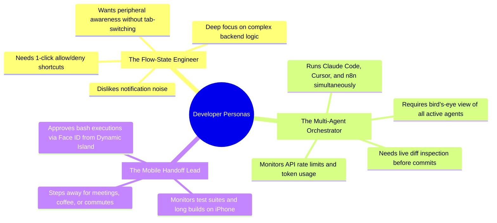
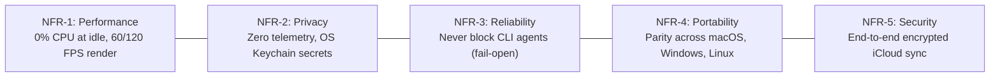

# Cocoa Notch — Product Requirements Document (PRD)

## 1. Document Control & Executive Summary

| Document Property | Specification |
| :--- | :--- |
| **Product Name** | **Cocoa Notch** (macOS: `NotchBuddy`, Windows/Linux: `Cocoa`, iOS: `CocoaPhone`) |
| **Document Version** | 2.0 (Post-Release Specification) |
| **Target Audience** | Software Engineers, DevOps Engineers, AI Agent Developers, Tech Leads |
| **Author / Lead** | Rohit (@Rohitpvt) & Contributors |
| **License** | Code: MIT / Assets, Name & Sound: All Rights Reserved |

### 1.1 Product Vision
**Cocoa Notch** transforms the dormant display notch on modern MacBooks (and the top screen bezel on Windows and Linux) into an ambient, intelligent, and tactile cockpit for AI coding agent sessions. By bridging terminal agents (Claude Code, Codex, Gemini CLI, Antigravity) with native desktop micro-interactions and mobile handoff via the iPhone Dynamic Island, Cocoa allows developers to maintain deep focus while keeping full command over their autonomous AI workforce.

---

## 2. Problem Statement & Market Opportunity

```
┌────────────────────────────────────────────────────────────────────────┐
│                        THE DEVELOPER BOTTLENECK                        │
├────────────────────────────────────────────────────────────────────────┤
│ 1. Terminal Alt-Tab Fatigue: Developers run long-running AI CLI tools   │
│    in hidden terminal tabs, constantly switching windows to check logs.│
│ 2. Blocked Execution Cycles: Agents sit stalled for minutes or hours   │
│    waiting for interactive tool permissions or clarifications.         │
│ 3. Blind Approvals: Tabbing to the CLI often leads to reflexively      │
│    pressing 'Enter' without verifying shell commands or file diffs.    │
│ 4. Desk Tethering: Leaving the workstation abruptly halts agent work,  │
│    delaying builds, tests, and deployments until the user returns.     │
└────────────────────────────────────────────────────────────────────────┘
```

Cocoa solves these pain points by offering an **ambient peripheral companion** that surfaces agent activity, permits one-click approvals, and syncs decision gates directly to the developer's pocket.

---

## 3. User Personas



---

## 4. Functional Requirements (FR)

### FR-1: Multi-Agent Session Ingestion & Auto-Pills
- **Description**: The system must ingest events from any CLI or IDE agent through a lightweight IPC relay (`cocoa-hook`).
- **Capabilities**:
  - Automatically allocate an active pill upon detecting a valid `cocoa_agent` tag matching `^[a-z0-9-]{1,24}$`.
  - Fallback cleanly to the primary workspace pill (Claude Code / Cursor) if untagged.
  - Support concurrent sessions across disparate tools (Claude Code, Gemini CLI, Codex, Antigravity, OpenCode, Amp).

### FR-2: Ambient Island Display Modes
- **Description**: Interface must dynamically transition between physical geometries based on user proximity and agent activity.
- **Modes**:
  - `hidden`: $100\%$ invisible; $0\%$ CPU overhead.
  - `peek`: Reveals Mochi upon mouse hover along the screen edge/notch.
  - `compact`: Micro-bar ($24\text{pt}$ high) displaying Mochi and a $2 \times 2$ mini-bot matrix for secondary tasks.
  - `expanded`: $640\text{pt}$ rich dashboard with cards, live diffs, and interactive prompts.

### FR-3: One-Click Approval & Decision Routing
- **Description**: Permission prompts must appear instantaneously with full security context.
- **Capabilities**:
  - Present shell commands and file mutations with clear visual separation.
  - Provide distinct triggers for **Allow (Y)**, **Deny (N)**, and **Always Allow**.
  - Interactive multi-select questions (`AskUserQuestion`) supporting up to 4 sequential queries, choices, and custom freeform text entry.
  - "Reply in terminal" fallback to safely relinquish control back to the CLI.

### FR-4: Real-Time Live Diff Inspector
- **Description**: Code modifications must be streamed to the island ticker as they occur.
- **Capabilities**:
  - Show file name and color-coded change counters (`+N −M`).
  - Clicking any ticker line opens the full inline diff inspector card with syntax highlighting.
  - Seamless jump link (↗) to open the modified file in the user's primary IDE (VS Code / Cursor).

### FR-5: In-Notch Multi-Model AI Chat
- **Description**: Developers can converse directly with AI models from the notch without launching a browser or IDE.
- **Capabilities**:
  - Model selector pill supporting Anthropic Claude, OpenAI GPT-4o, Google Gemini, and local LLMs (Ollama / LM Studio).
  - Streaming markdown rendering with syntax-highlighted code blocks.
  - Local voice dictation via native speech recognition on supported hardware.

### FR-6: Detached Desktop Mochi Companion
- **Description**: Users can drag Mochi out of the notch to roam freely on the desktop.
- **Capabilities**:
  - Floats as a $120\text{pt} \times 120\text{pt}$ borderless, semi-transparent window.
  - Spherical eye tracking follows the global cursor.
  - Idle breathing, heart reactions on hover, dizzy reactions on multiple clicks.
  - Automatic recall to notch upon critical alerts or double-clicking.

### FR-7: Mobile Handoff (iOS CocoaPhone & Dynamic Island)
- **Description**: Agent status, questions, and decisions must seamlessly bridge to iPhone.
- **Capabilities**:
  - Real-time updates via Dynamic Island and Lock Screen Live Activities.
  - Actionable push notifications for remote approvals.
  - Biometric authorization: Every remote "Allow" requires explicit Face ID / Touch ID validation.
  - Zero-server setup: Synchronizes via private iCloud CloudKit database.

### FR-8: System Hardware & Performance Monitoring
- **Description**: Developers can toggle ambient system performance meters in the notch header.
- **Capabilities**:
  - Real-time CPU usage percentage.
  - GPU load and GPU temperature monitoring.
  - RAM memory utilization.

### FR-9: Developer Welfare & Ergonomic Health
- **Description**: Mochi proactively reminds developers to care for their physical well-being.
- **Capabilities**:
  - Configurable interval reminders for hydration, posture correction, and 20-20-20 eye rest.
  - Gentle "Night Owl" alerts for work sessions running past 23:00.
  - Interactive "Thanks Mochi! ✨" responses triggering playful animations.

### FR-10: Privacy-Preserving Weekly Productivity Recap
- **Description**: Summarizes developer productivity locally every Monday morning.
- **Capabilities**:
  - Aggregates hours coded, sessions, lines added/removed, commands run, and decisions made.
  - Generates a polished $1080 \times 1920$ shareable image.
  - $100\%$ local computation; sensitive project names are optionally masked.

---

## 5. Non-Functional Requirements (NFR)



| ID | Category | Requirement Specification |
| :--- | :--- | :--- |
| **NFR-1** | **Performance** | When the island is in `hidden` mode, CPU usage must measure strictly $0.0\%$. UI rendering in `expanded` mode must sustain $60\text{Hz}$ / $120\text{Hz}$ with zero frame drops ($<16.6\text{ms}$ per frame). Memory consumption must remain $<50\text{MB}$ RSS. |
| **NFR-2** | **Privacy & Security** | Zero telemetry, analytics, or external crash reporting. Secrets stored exclusively in macOS Keychain, Windows Credential Manager, or Linux Secret Service. Code snippets and bash commands must never be saved to persistent recap logs. |
| **NFR-3** | **Fail-Open Reliability** | The CLI relay (`cocoa-hook`) must enforce a hard $200\text{ms}$ timeout. If Cocoa is closed or unready, the hook must exit cleanly with code 0 without interrupting agent execution. External configuration edits must generate timestamped backups before writing. |
| **NFR-4** | **Platform Parity** | Windows and Linux editions (Tauri 2) must offer identical feature parity with macOS where physically possible (screen bezel mode, global shortcuts, Mochi canvas engine, credential storage, and IPC relays). |
| **NFR-5** | **Cloud Encryption** | Mobile data sync via Apple CloudKit must use client-side field-level encryption (`record.encryptedValues`) using the user's private iCloud keys. No intermediary Cocoa server can decrypt session content. |

---

## 6. Success Metrics & Key Performance Indicators (KPIs)

```
┌────────────────────────────────────────────────────────────────────────┐
│                        TARGET SUCCESS METRICS                          │
├────────────────────────────────────────────────────────────────────────┤
│ • Decision Latency: Reduce time-to-approve from 45s down to < 5s.      │
│ • Zero Interruptions: 100% fail-open rate on CLI hook disconnections.  │
│ • Performance Budget: 0.0% CPU confirmed across 100% of idle periods.   │
│ • Stability: > 99.95% crash-free sessions across all active OS builds. │
│ • User Delight: > 80% of active users keep Mochi sound/emotes enabled. │
└────────────────────────────────────────────────────────────────────────┘
```
