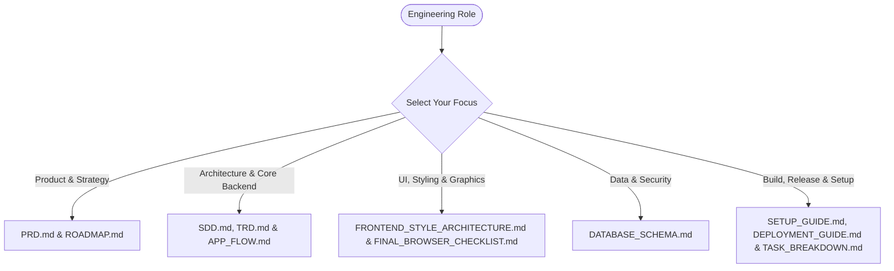

# Cocoa Notch — Engineering Documentation Hub

Welcome to the central technical documentation repository for **Cocoa Notch** (`NotchBuddy`, `Cocoa for Windows/Linux`, and `CocoaPhone`). This knowledge base provides comprehensive architectural diagrams, protocol specifications, database schemas, deployment instructions, and product guidelines.

---

## 1. Documentation Index

The table below indexes all engineering specifications, design documents, and operational guides available in this directory:

| Document | Scope & Focus Area | Target Audience |
| :--- | :--- | :--- |
| **[APP_FLOW.md](file:///C:/Users/rghos/OneDrive%20-%20Vivekananda%20Institute%20of%20Professional%20Studies/PROJECTS/Cocoa%20Notch/docs/APP_FLOW.md)** | End-to-end operational flows, state transitions, IPC relays, and mobile handoff lifecycles. | Core Engineers, Systems Architects |
| **[DATABASE_SCHEMA.md](file:///C:/Users/rghos/OneDrive%20-%20Vivekananda%20Institute%20of%20Professional%20Studies/PROJECTS/Cocoa%20Notch/docs/DATABASE_SCHEMA.md)** | Keyring secrets storage, `recap.json` schemas, `settings.json`, and encrypted CloudKit models. | Database & Systems Engineers |
| **[DEPLOYMENT_GUIDE.md](file:///C:/Users/rghos/OneDrive%20-%20Vivekananda%20Institute%20of%20Professional%20Studies/PROJECTS/Cocoa%20Notch/docs/DEPLOYMENT_GUIDE.md)** | Build instructions, code signing, notarization, installer generation, and release automation. | Release Engineers, DevOps |
| **[FINAL_BROWSER_CHECKLIST.md](file:///C:/Users/rghos/OneDrive%20-%20Vivekananda%20Institute%20of%20Professional%20Studies/PROJECTS/Cocoa%20Notch/docs/FINAL_BROWSER_CHECKLIST.md)** | WebView2/WebKit checklist, GitHub Pages web QA, security link audits, and performance budgets. | QA Engineers, Web Developers |
| **[FRONTEND_STYLE_ARCHITECTURE.md](file:///C:/Users/rghos/OneDrive%20-%20Vivekananda%20Institute%20of%20Professional%20Studies/PROJECTS/Cocoa%20Notch/docs/FRONTEND_STYLE_ARCHITECTURE.md)** | Liquid Glass design system, color tokens, procedural Mochi vector engine, and spring physics. | UI/UX Designers, Frontend Engineers |
| **[PRD.md](file:///C:/Users/rghos/OneDrive%20-%20Vivekananda%20Institute%20of%20Professional%20Studies/PROJECTS/Cocoa%20Notch/docs/PRD.md)** | Product vision, target personas, functional requirements (FR), non-functional constraints (NFR), and KPIs. | Product Managers, Stakeholders |
| **[README.md](file:///C:/Users/rghos/OneDrive%20-%20Vivekananda%20Institute%20of%20Professional%20Studies/PROJECTS/Cocoa%20Notch/docs/README.md)** | Documentation directory map, role-based navigation paths, and project structure overview. | All Engineers & Contributors |
| **[ROADMAP.md](file:///C:/Users/rghos/OneDrive%20-%20Vivekananda%20Institute%20of%20Professional%20Studies/PROJECTS/Cocoa%20Notch/docs/ROADMAP.md)** | Feature milestones, version releases, upcoming multi-agent canvases, and long-term goals. | Product Managers, Core Team |
| **[SDD.md](file:///C:/Users/rghos/OneDrive%20-%20Vivekananda%20Institute%20of%20Professional%20Studies/PROJECTS/Cocoa%20Notch/docs/SDD.md)** | Software Design Document: Subsystems, polyglot IPC architecture, security, and threading models. | Systems Architects, Senior Engineers |
| **[SETUP_GUIDE.md](file:///C:/Users/rghos/OneDrive%20-%20Vivekananda%20Institute%20of%20Professional%20Studies/PROJECTS/Cocoa%20Notch/docs/SETUP_GUIDE.md)** | Step-by-step developer onboarding, toolchains, local environment setup, and debugging tips. | New Contributors, Developers |
| **[TASK_BREAKDOWN.md](file:///C:/Users/rghos/OneDrive%20-%20Vivekananda%20Institute%20of%20Professional%20Studies/PROJECTS/Cocoa%20Notch/docs/TASK_BREAKDOWN.md)** | Work Breakdown Structure (WBS), sprint schedules, actionable task cards, and risk matrices. | Project Managers, Scrum Masters |
| **[TRD.md](file:///C:/Users/rghos/OneDrive%20-%20Vivekananda%20Institute%20of%20Professional%20Studies/PROJECTS/Cocoa%20Notch/docs/TRD.md)** | Technical Requirements Document: IPC protocol schemas, performance envelopes, and network APIs. | Systems Architects, Security Leads |

---

## 2. Navigational Pathways by Engineering Role



### 2.1 For Product Managers & Strategists
- Review **[PRD.md](file:///C:/Users/rghos/OneDrive%20-%20Vivekananda%20Institute%20of%20Professional%20Studies/PROJECTS/Cocoa%20Notch/docs/PRD.md)** for user personas, feature definitions, and KPI targets.
- Consult **[ROADMAP.md](file:///C:/Users/rghos/OneDrive%20-%20Vivekananda%20Institute%20of%20Professional%20Studies/PROJECTS/Cocoa%20Notch/docs/ROADMAP.md)** for release milestones, scheduled capabilities, and long-term technical horizons.

### 2.2 For Systems Architects & Core Developers
- Inspect **[SDD.md](file:///C:/Users/rghos/OneDrive%20-%20Vivekananda%20Institute%20of%20Professional%20Studies/PROJECTS/Cocoa%20Notch/docs/SDD.md)** for subsystem modularization, thread affinity, and IPC daemon design.
- Read **[APP_FLOW.md](file:///C:/Users/rghos/OneDrive%20-%20Vivekananda%20Institute%20of%20Professional%20Studies/PROJECTS/Cocoa%20Notch/docs/APP_FLOW.md)** for state machines, interaction lifecycles, and CloudKit sync sequences.
- Verify protocol contracts in **[TRD.md](file:///C:/Users/rghos/OneDrive%20-%20Vivekananda%20Institute%20of%20Professional%20Studies/PROJECTS/Cocoa%20Notch/docs/TRD.md)** for socket schemas, timing constraints, and memory limits.

### 2.3 For Frontend, UI/UX & Graphics Engineers
- Read **[FRONTEND_STYLE_ARCHITECTURE.md](file:///C:/Users/rghos/OneDrive%20-%20Vivekananda%20Institute%20of%20Professional%20Studies/PROJECTS/Cocoa%20Notch/docs/FRONTEND_STYLE_ARCHITECTURE.md)** to master the Liquid Glass token palette, procedural Mochi vector rendering, and spring dynamics.
- Execute **[FINAL_BROWSER_CHECKLIST.md](file:///C:/Users/rghos/OneDrive%20-%20Vivekananda%20Institute%20of%20Professional%20Studies/PROJECTS/Cocoa%20Notch/docs/FINAL_BROWSER_CHECKLIST.md)** for cross-browser, WebView2, and accessibility certification.

### 2.4 For DevOps, QA & Platform Engineers
- Follow **[SETUP_GUIDE.md](file:///C:/Users/rghos/OneDrive%20-%20Vivekananda%20Institute%20of%20Professional%20Studies/PROJECTS/Cocoa%20Notch/docs/SETUP_GUIDE.md)** for rapid workstation setup across macOS, Windows, and Linux.
- Reference **[DEPLOYMENT_GUIDE.md](file:///C:/Users/rghos/OneDrive%20-%20Vivekananda%20Institute%20of%20Professional%20Studies/PROJECTS/Cocoa%20Notch/docs/DEPLOYMENT_GUIDE.md)** for Apple Notarization, Windows Authenticode, SmartScreen mitigation, and CI/CD pipelines.
- Manage execution timelines via **[TASK_BREAKDOWN.md](file:///C:/Users/rghos/OneDrive%20-%20Vivekananda%20Institute%20of%20Professional%20Studies/PROJECTS/Cocoa%20Notch/docs/TASK_BREAKDOWN.md)**.

---

## 3. System Architecture Quick Reference

Cocoa Notch is structured across four primary codebases in this repository:

```
Cocoa Notch/
├── NotchBuddy/             # Native macOS & iOS application (Swift 6, SwiftUI, AppKit)
│   ├── Sources/App/        # macOS NotchBuddy implementation (IslandWindow, HookServer)
│   ├── Sources/CocoaKit/   # Shared logic with iOS (BotEngine, DiffEngine, PillCatalog)
│   ├── Sources/Phone/      # iOS CocoaPhone companion application
│   └── Sources/Widgets/    # iOS Live Activities & Dynamic Island WidgetKit extensions
├── windows/                # Cross-platform Windows & Linux client (Tauri 2)
│   ├── src-tauri/          # Rust backend (Named Pipes, Windows Credential Manager, Recap)
│   ├── src/                # TypeScript + HTML5 Canvas frontend (Liquid Glass UI)
│   └── hook/               # Standalone cocoa-hook.exe relay binary for Windows/Linux
├── relay/                  # Stateless Cloudflare Worker (APNs Live Activity push gateway)
├── design/                 # Visual sources of truth, animations, and prototype reference
└── docs/                   # Complete architectural and engineering documentation (This hub)
```

---

## 4. Contributing & Architectural Rules

When contributing code or modifying existing documentation:
1. **Preserve Existing Styling**: Never restyle existing production views (pills, cards, chat) unless explicitly requested.
2. **Bundle Identifiers**: Never change `fr.louisraille.NotchBuddy` or `iCloud.fr.louisraille.Cocoa`.
3. **Pill Stability**: Pill identifiers (`agent_claude`, `workspace_cursor`, `service_github`) are stable database contracts; never rename or remove an existing pill ID.
4. **Agent Safety**: The CLI relay must **never block** agent operations. If Cocoa does not acknowledge within $200\text{ms}$, the relay must exit code 0.
5. **No Telemetry**: Absolutely zero telemetry, tracking beacons, or background phone-home calls are permitted.
