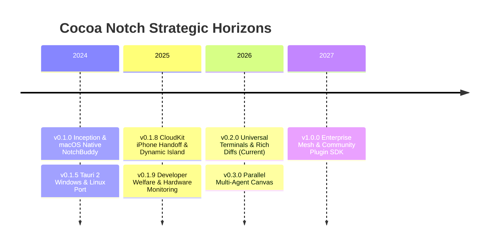
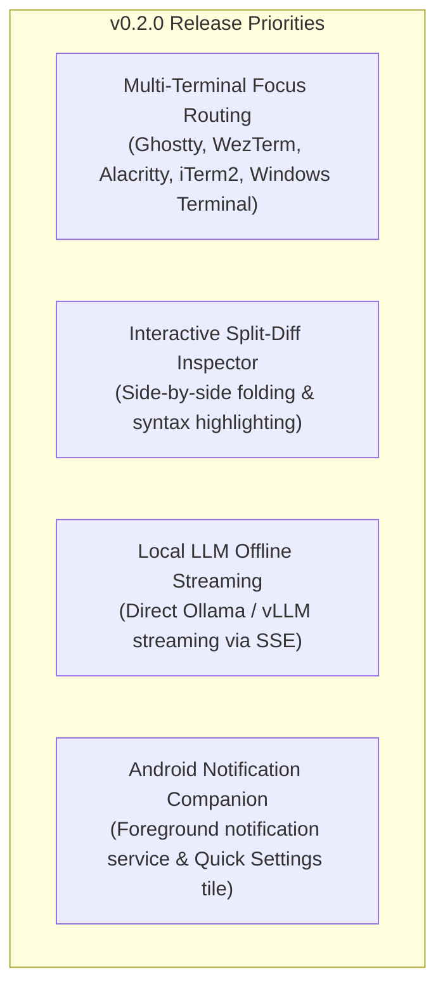
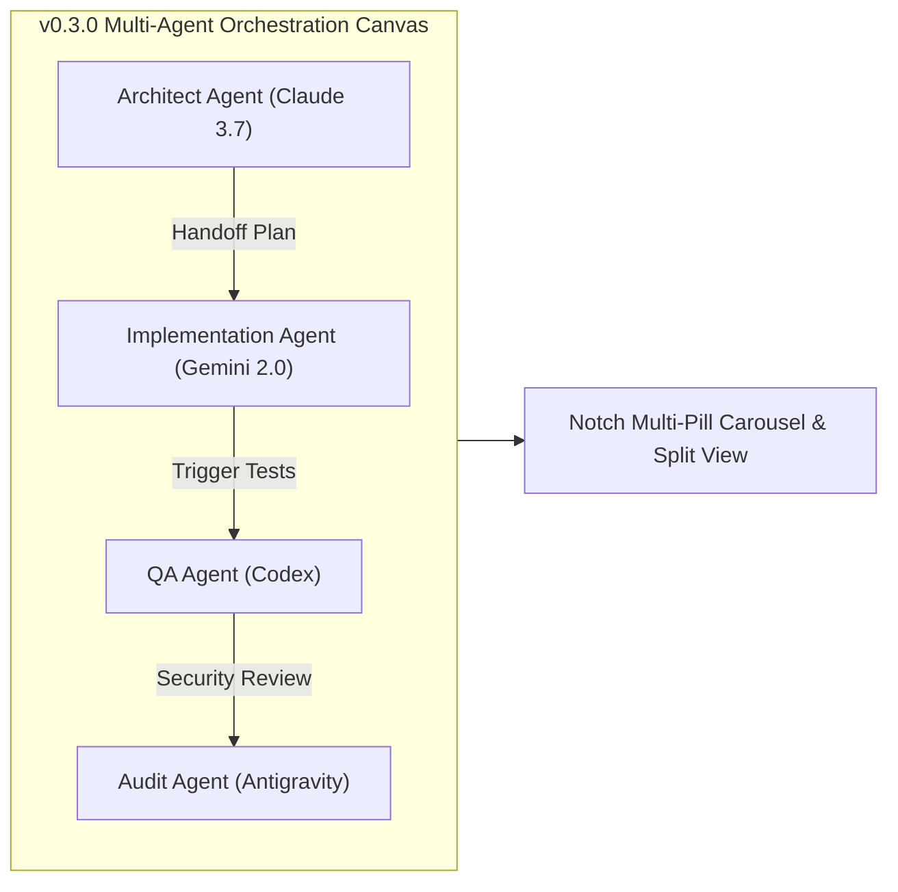
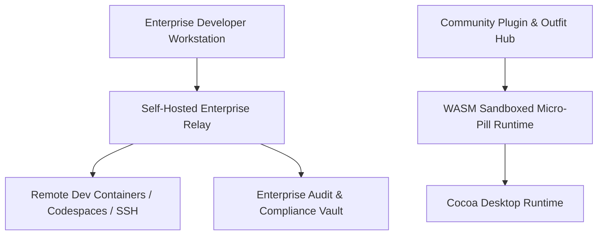

# Cocoa Notch — Strategic Product & Technical Roadmap

## 1. Vision & Strategic Evolution

Cocoa Notch originated as an elegant macOS novelty: a tiny, delightful companion living inside the MacBook notch to monitor Claude Code. It has evolved into a **cross-platform AI developer cockpit** spanning macOS, Windows 11, Linux, and iOS.

Our long-term mission is to build the standard peripheral interface for autonomous software engineering — offering ambient observability, instant biometric approvals, and deep integration with developer workflows without cluttering screen real estate.



---

## 2. Release History & Completed Milestones

```
┌────────────────────────────────────────────────────────────────────────┐
│                        COMPLETED MILESTONES                            │
├────────────────────────────────────────────────────────────────────────┤
│ • v0.1.0 - v0.1.4: Native macOS AppKit/SwiftUI core (NotchBuddy),      │
│   zero-raster vector Mochi canvas, 28 spatial sound effects.           │
│ • v0.1.5 - v0.1.7: Windows 10/11 and Linux port via Tauri 2,           │
│   Windows Named Pipe relay (cocoa-hook.exe), Detached Desktop Mochi.   │
│ • v0.1.8: iOS CocoaPhone companion, Dynamic Island Live Activities,    │
│   zero-server private CloudKit sync, Cloudflare APNs push relay.       │
│ • v0.1.9: Developer Welfare & wellness reminders, Hardware telemetry   │
│   meters (CPU/GPU/RAM/Temp), Weekly productivity recap generator.      │
└────────────────────────────────────────────────────────────────────────┘
```

---

## 3. Current Phase: v0.2.x (Rich Diffs, Terminal Jump & Local LLMs)

**Primary Objective**: Refine developer ergonomics, eliminate context-switching friction, and deepen terminal integration across modern developer toolchains.



### Feature Roadmap: v0.2.x Cycle

| Feature / Initiative | Target Milestone | Description & Impact | Complexity | Status |
| :--- | :--- | :--- | :--- | :--- |
| **Universal Terminal Targeting** | v0.2.0 | Jump directly to the active terminal tab of a session across Windows Terminal, Ghostty, WezTerm, Alacritty, iTerm2, and VS Code Terminal. | Medium | In Progress |
| **Advanced Split Diff Viewer** | v0.2.0 | Expand ticker modifications into side-by-side or unified inline diffs with syntax highlighting and direct IDE file jump links. | Medium | Beta Testing |
| **Local LLM Streaming** | v0.2.1 | Native Server-Sent Events (SSE) streaming for local models running on Ollama, LM Studio, and llama.cpp. | Low | In Review |
| **Windows SmartScreen EV Signing** | v0.2.1 | Integrate hardware token EV code signing into GitHub Actions CI to permanently eliminate SmartScreen warnings. | Low | Scheduled |
| **Android Companion Prototype** | v0.2.2 | Initial Android release (`android/app`) mirroring iOS Live Activities via Android 14/15 Persistent Rich Notifications. | High | Architecture |

---

## 4. Near-Term Phase: v0.3.x (Parallel Multi-Agent Canvas)

**Primary Objective**: Support multi-agent orchestration where teams of specialized AI agents (e.g. planner, coder, tester, reviewer) operate concurrently.



### Capabilities Planned for v0.3.x:
1. **Multi-Agent Split Deck**: Expand the island to accommodate multiple active agent columns simultaneously without losing individual ticker progress.
2. **Automated Agent-to-Agent Handoff**: Enable users to pipe output from a planning session directly into a code-generation session with a single confirmation.
3. **Voice Review & Approval**: Hands-free voice recognition allowing developers to say *"Allow"* or *"Deny"* while reviewing code from across the room.
4. **Enhanced Service Actions**: Two-way interactive triggers for GitHub (merge PR after green CI), Vercel (promote preview to production), and Stripe (generate test refund).

---

## 5. Long-Term Vision: v1.0.0+ (Enterprise Mesh & Community Plugins)



### 5.1 Community Plugin & Outfit SDK
- **WASM-Powered Micro-Pills**: Provide a sandboxed WebAssembly SDK allowing third-party services (e.g., Jira, Datadog, AWS, Linear) to register custom pills and micro-cards inside Cocoa.
- **Custom Wardrobe Submissions**: Enable artists and designers to create procedural or vector outfits for Mochi with an open submission marketplace.

### 5.2 Enterprise Cloud & Remote Mesh
- **Remote SSH & Codespaces Agent Bridge**: Forward hook payloads from remote Linux development boxes (AWS EC2, GitHub Codespaces, Google Cloud Workstations) directly to the local desktop notch over secure TLS tunnels.
- **Air-Gapped Corporate Mode**: Full functionality without external internet access, routing all model calls to internal corporate LLM proxies with complete cryptographic audit logging.

---

## 6. Release Schedule & Milestone Gates

```
┌────────────────────────────────────────────────────────────────────────┐
│                      QUARTERLY EXECUTION MATRIX                        │
├────────────────────────────────────────────────────────────────────────┤
│ • Q4 2026: v0.2.0 Release (Universal Terminals, Split Diffs)          │
│ • Q1 2027: v0.2.2 Release (Android Companion Alpha, Local LLM Stream)  │
│ • Q2 2027: v0.3.0 Release (Multi-Agent Split Deck, Voice Approvals)    │
│ • Q3 2027: v0.4.0 Release (Remote SSH Hook Tunnels, Plugin Sandbox)   │
│ • Q4 2027: v1.0.0 General Availability (Enterprise Certified)          │
└────────────────────────────────────────────────────────────────────────┘
```
