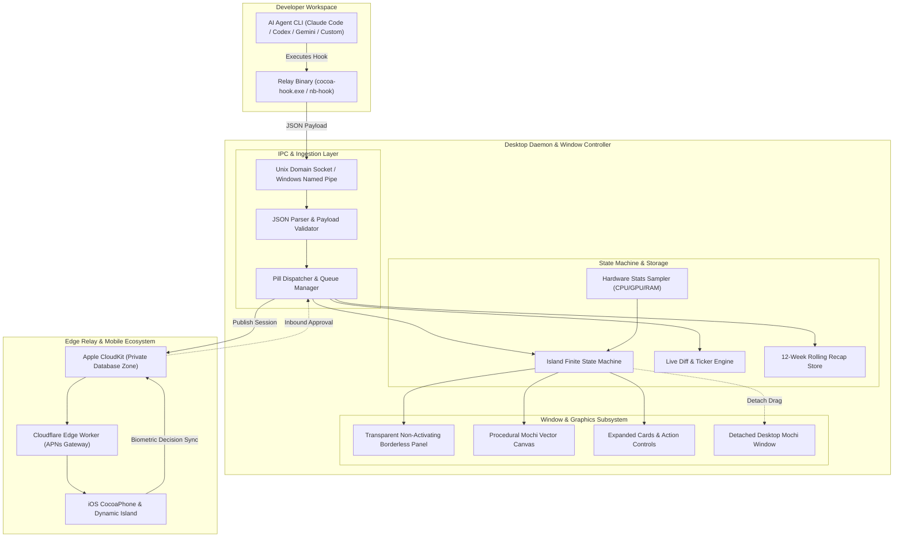
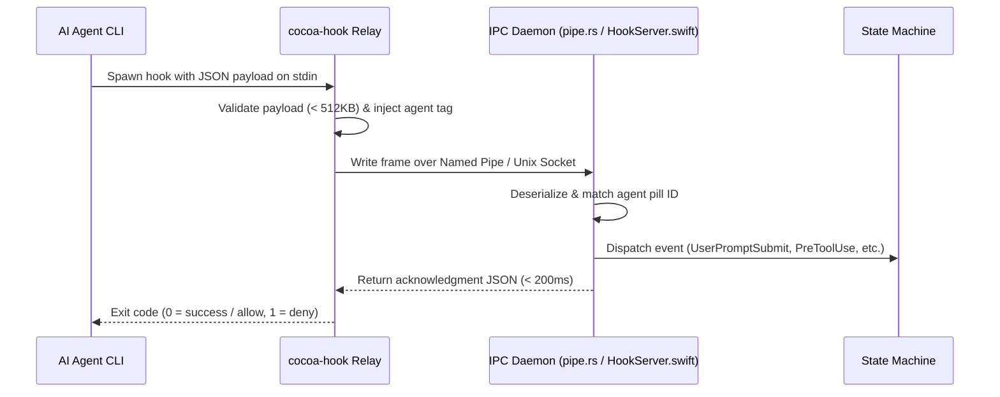
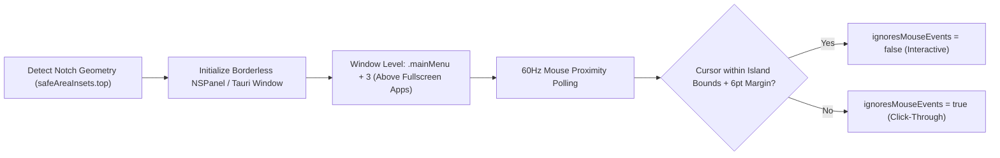
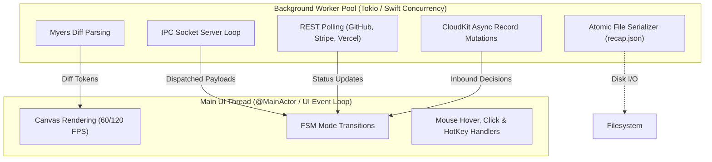

# Cocoa Notch — Software Design Document (SDD)

## 1. System Architecture & High-Level Topology

Cocoa Notch is engineered as a **polyglot, multi-tiered desktop and mobile system**. It bridges low-level system hooks, an IPC daemon, an ambient graphical overlay, secure local persistence, and cross-device edge synchronization.



---

## 2. Subsystem Decomposition

### 2.1 IPC Daemon Subsystem
The IPC layer is responsible for low-latency, non-blocking ingestion of agent lifecycle events.



- **macOS / Linux IPC**: Unix Domain Socket bound to `/tmp/cocoa.sock` (macOS) or `~/.local/share/cocoa/socket` (Linux).
- **Windows IPC**: Windows Named Pipe bound to `\\.\pipe\cocoa-agent`.
- **Fail-Safe Mechanism**: The relay enforces a strict $200\text{ms}$ socket timeout. If the Cocoa desktop app is closed or busy, the relay exits immediately with code 0 to ensure developer workflows are never frozen.

### 2.2 Window Management & Click-Through Subsystem

The island window operates as a floating borderless overlay positioned at the extreme top-center of the screen.



- **macOS Window Spec**: `NSPanel` with styles `[.borderless, .nonactivatingPanel]`, transparent backing store, and `collectionBehavior [.canJoinAllSpaces, .stationary, .fullScreenAuxiliary, .ignoresCycle]`.
- **Windows / Linux Spec**: Tauri 2 borderless window with transparent framebuffer (`alpha: 0.0`), topmost flag enabled, and custom hit-test region forwarding.

### 2.3 Live Diff & Task Ticker Engine (`DiffEngine.swift` / `diff.ts`)
The diff engine parses and highlights code mutations on the fly without burdening system memory:
- **Algorithm**: Optimized Myers diff computation executed on background threads.
- **Safety Thresholds**: Files exceeding $200\text{KB}$, $4000$ lines, or $1,000,000$ comparison cells are counted rather than diffed line-by-line to prevent UI stutter.
- **Task Ticker**: A 4-line vertical marquee rendering previous, current, and upcoming agent steps. The active step renders an animated shimmer shader and shifts upward every $2.8\text{s}$.

### 2.4 Procedural Mochi Canvas & Wardrobe Engine
Mochi is rendered entirely through vector drawing instructions on a 2D canvas:
- **Body & Concaves**: Continuous-curvature cubic Bezier curves creating the squircle torso and the two $14\text{pt}$ concave top-corner "ears" that visually merge into the notch bezel.
- **Pupil Math**: Spherical coordinate projection calculating pupil offset based on global cursor distance.
- **Wardrobe Manager**: Contextual outfit rendering system triggered automatically by date (Halloween, Christmas) or chosen manually via the custom context menu.

### 2.5 Cross-Device CloudKit & Edge Push Subsystem
- **Private Database**: Connects to the user's private iCloud database (`iCloud.fr.louisraille.Cocoa`) in the custom zone `Cocoa`.
- **End-to-End Field Encryption**: Commands, project directory names, and prompts are written using `CKRecord.encryptedValues`.
- **Cloudflare Edge Worker**: A stateless worker deployed on Cloudflare Workers holding the Apple Developer APNs private key. It converts CloudKit database modification pings into APNs Live Activity push alerts targeting the user's iPhone Dynamic Island.

---

## 3. Concurrency & Threading Model



1. **Main UI Thread**:
   - macOS: Strictly isolated to `@MainActor` to avoid AppKit / SwiftUI data races.
   - Tauri: Frontend UI thread executing JavaScript animations with `requestAnimationFrame`.
2. **Background Async Tasks**:
   - IPC named pipe connections, diff computations, and HTTP integration pollers execute on background threads via Swift structured concurrency (`Task.detached`) or Tokio runtime workers in Rust.
3. **Zero-CPU Idle Suspension**:
   - In `hidden` mode, display link timers and canvas rendering loops are paused, guaranteeing $0.0\%$ CPU overhead.

---

## 4. Security, Sandboxing & Credential Isolation

```mermaid
flowchart LR
    subgraph SecretVault["Operating System Secure Enclave"]
        KC["macOS Keychain Services"]
        WCM["Windows Credential Manager"]
        SS["Linux Secret Service"]
    end

    subgraph AppIsolation["Application Memory Space"]
        CoreDaemon["Cocoa Core Engine"]
        KeyringModule["keyring / secrets.rs Interface"]
    end

    subgraph PublicSurface["Unprivileged UI / Webview"]
        WebViewUI["Liquid Glass UI"]
    end

    SecretVault <==>|Encrypted Credential Retrieval| KeyringModule
    KeyringModule --- CoreDaemon
    CoreDaemon -->|Presence Booleans Only (true/false)| WebViewUI
```

- **No Plaintext Tokens**: API keys and service tokens are never stored on disk or passed to the webview UI. The UI only queries whether a token is configured (`hasKey: boolean`).
- **Input Sanitization**: All inbound agent tags are validated against `^[a-z0-9-]{1,24}$` to eliminate path traversal or injection vulnerabilities.
- **Atomic File Mutators (`config_file.rs` / `ClaudeSettingsFile.swift`)**:
  - Validates SHA-256 fingerprint of target config before writing.
  - Automatically writes a timestamped backup copy (`.bak.<timestamp>`).
  - Writes new bytes to a sibling temporary file, synchronizes buffers, and executes an atomic filesystem rename.

---

## 5. Architectural Quality Attributes

| Quality Attribute | Architectural Design Decision | Verification Metric |
| :--- | :--- | :--- |
| **Performance** | Paused `TimelineView` / `rAF` during `hidden` state; 0 external raster dependencies. | $0.0\%$ CPU usage at idle verified in Activity Monitor / Task Manager. |
| **Reliability** | Fail-open IPC relays with $200\text{ms}$ socket timeouts; atomic config renames. | Zero blocking of agent CLIs under process termination. |
| **Portability** | Abstraction of platform differences (Named Pipes vs Unix Sockets; Keychain vs Credential Manager). | $100\%$ feature parity between macOS and Windows/Linux builds. |
| **Security** | Zero telemetry; OS secure enclave storage; CloudKit encrypted fields. | Static security audits confirm zero outbound analytics pings. |
