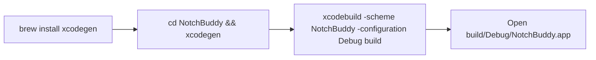
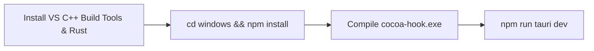

# Cocoa Notch — Developer Onboarding & Environment Setup Guide

## 1. Prerequisites & Environment Matrix

Before contributing to or building Cocoa Notch, ensure your development workstation meets the platform-specific requirements:

| Platform | Required Toolchains & Runtimes | Package Manager / Installers |
| :--- | :--- | :--- |
| **macOS** | macOS 15.0+ (Sequoia), Xcode 16.0+, Swift 6.0, XcodeGen | `brew install xcodegen` |
| **Windows** | Windows 10 / 11 (64-bit), Visual Studio 2022 C++ Tools, Rust 1.80+, Node.js 20+ | `winget install Rustlang.Rustup OpenJS.NodeJS` |
| **Linux** | Ubuntu 22.04+ / Fedora 38+, WebKitGTK 4.1, GTK 3, Rust 1.80+, Node.js 20+ | `apt install build-essential libwebkit2gtk-4.1-dev` |
| **iOS** | iOS 18.0+, Xcode 16.0+, Apple Developer Account (for CloudKit) | Bundled in `NotchBuddy/` Xcode workspace |
| **Relay** | Node.js 20+, Cloudflare Wrangler CLI | `npm install -g wrangler` |

---

## 2. Cloning & Workspace Organization

Clone the repository and inspect the directory structure:

```bash
git clone https://github.com/Rohitpvt/Cocoa-Notch.git
cd "Cocoa-Notch"
```

```
Cocoa Notch/
├── NotchBuddy/             # Native macOS & iOS codebase (Swift 6)
│   ├── Sources/App/        # macOS NotchBuddy implementation
│   ├── Sources/CocoaKit/   # Shared logic (BotEngine, DiffEngine, PillCatalog)
│   ├── Sources/Phone/      # iOS CocoaPhone companion application
│   └── project.yml         # Declarative XcodeGen configuration
├── windows/                # Cross-platform Windows & Linux application (Tauri 2)
│   ├── src-tauri/          # Rust core backend (Named Pipes, Windows Credential Manager)
│   ├── src/                # TypeScript + HTML5 Canvas frontend
│   └── hook/               # Standalone cocoa-hook CLI relay source
├── relay/                  # Stateless Cloudflare Worker (APNs push gateway)
├── scripts/                # Automated build and test scripts
├── tests/                  # Swift & Python unit/integration tests
└── docs/                   # Complete project documentation hub
```

---

## 3. macOS Setup & Build (`NotchBuddy`)

The macOS application is generated from `NotchBuddy/project.yml`. Never edit `.xcodeproj` files manually.



### 3.1 Step-by-Step Instructions
1. Install **XcodeGen**:
   ```bash
   brew install xcodegen
   ```
2. Generate the Xcode project:
   ```bash
   cd NotchBuddy
   xcodegen generate
   ```
3. Open the project in Xcode:
   ```bash
   open NotchBuddy.xcodeproj
   ```
4. In Xcode, select the **`NotchBuddy`** scheme and click **Run** (`Cmd + R`), or compile from the terminal:
   ```bash
   xcodebuild -scheme NotchBuddy -configuration Debug -destination 'platform=macOS' build
   ```
5. On first launch, grant **Notification** and **Accessibility** permissions when prompted.

---

## 4. Windows Setup & Build (Tauri 2)



### 4.1 Step-by-Step Instructions
1. Install **Visual Studio 2022 C++ Build Tools**: Ensure the *Desktop development with C++* workload is selected.
2. Install **Rust**:
   ```powershell
   winget install Rustlang.Rustup
   rustup default stable-x86_64-pc-windows-msvc
   ```
3. Install **Node.js 20+ LTS**:
   ```powershell
   winget install OpenJS.NodeJS
   ```
4. Navigate to the `windows` directory and install dependencies:
   ```powershell
   cd windows
   npm install
   ```
5. Compile the standalone CLI hook (`cocoa-hook.exe`):
   ```powershell
   cargo build --release --manifest-path hook/Cargo.toml
   Copy-Item hook/target/release/cocoa-hook.exe ../cocoa-hook.exe
   ```
6. Launch the development server with live reload:
   ```powershell
   npm run tauri dev
   ```

---

## 5. Linux Setup & Build

### 5.1 Install System Libraries (Ubuntu / Debian)
```bash
sudo apt-get update && sudo apt-get install -y \
  build-essential curl wget libssl-dev libgtk-3-dev \
  libwebkit2gtk-4.1-dev libappindicator3-dev librsvg2-dev patchelf
```

### 5.2 Build & Run
```bash
cd windows
npm install
npm run tauri dev
```

---

## 6. Configuring AI Agent Hooks

Cocoa intercepts events from your favorite AI coding agents.

### 6.1 Automatic Hook Configuration
1. Launch Cocoa.
2. Open **Settings** ($\text{Ctrl} + ,$ or click the tray icon $\rightarrow$ *Settings*).
3. Navigate to **Agents** and toggle **Install Claude Code Hooks** or **Install Codex Hooks**. Cocoa automatically merges the required hook configurations into `~/.claude/settings.json`.

### 6.2 Manual Configuration (`~/.claude/settings.json`)
If you prefer manual configuration, add the following to your Claude Code settings file:

```json
{
  "hooks": {
    "UserPromptSubmit": [
      { "type": "command", "command": "C:\\path\\to\\cocoa-hook.exe" }
    ],
    "PreToolUse": [
      { "type": "command", "command": "C:\\path\\to\\cocoa-hook.exe" }
    ],
    "PostToolUse": [
      { "type": "command", "command": "C:\\path\\to\\cocoa-hook.exe" }
    ],
    "Stop": [
      { "type": "command", "command": "C:\\path\\to\\cocoa-hook.exe" }
    ]
  }
}
```

*For custom agents, tag the payload with `--agent <your-name>`:*
```json
{ "type": "command", "command": "/path/to/cocoa-hook --agent my-custom-agent" }
```

---

## 7. Running Unit & Integration Test Suites

Cocoa includes a comprehensive automated test suite in `scripts/` and `tests/`:

```bash
# Run Claude hook detection tests
./scripts/test-claude-hooks.sh

# Run DiffEngine performance benchmarks
./scripts/test-diff-engine.sh

# Run Island Auto-Close logic tests
./scripts/test-auto-close.sh

# Test local LLM proxy integration
python3 tests/fake_local_llm.py
```

---

## 8. Common Pitfalls & Troubleshooting

### 8.1 macOS
- **Problem**: `xcodebuild: error: 'NotchBuddy.xcodeproj' does not exist.`
  - **Solution**: Run `cd NotchBuddy && xcodegen generate` to generate the project file.
- **Problem**: Mochi sound effects do not play.
  - **Solution**: Verify sound is enabled in **Settings $\rightarrow$ General $\rightarrow$ Sound** and macOS volume is above zero.

### 8.2 Windows
- **Problem**: Windows Defender flags the installer (`Trojan:Win32/Wacatac.H!ml`).
  - **Solution**: This is a known machine-learning false positive. Run `Update-MpSignature` in an administrative PowerShell terminal to download updated Microsoft definitions.
- **Problem**: `cocoa-hook.exe` fails to connect to the named pipe.
  - **Solution**: Ensure Cocoa is running in the background before running agent commands. Verify the pipe exists at `\\.\pipe\cocoa-agent`.

### 8.3 Linux
- **Problem**: Error compiling `libwebkit2gtk` bindings.
  - **Solution**: Ensure you installed `libwebkit2gtk-4.1-dev` (WebKit 4.1) rather than the older `libwebkit2gtk-4.0-dev`.
