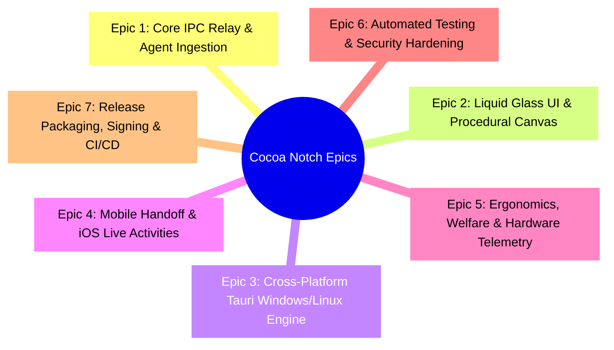
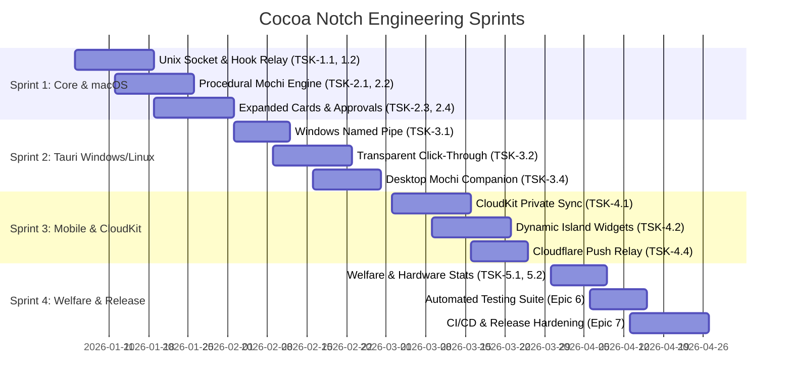

# Cocoa Notch — Work Breakdown Structure (WBS) & Sprint Plan

## 1. Executive Summary & Epics Architecture

This document breaks down the development of Cocoa Notch into structured, actionable engineering tasks across seven core architectural epics:

---

## 2. Granular Task Cards

### Epic 1: Core IPC Relay & Agent Ingestion

| Task ID | Task Title & Scope | Files / Components | Effort | Dependencies | Acceptance Criteria |
| :--- | :--- | :--- | :--- | :--- | :--- |
| **TSK-1.1** | **Unix Socket Daemon Implementation** | `NotchBuddy/Sources/App/HookServer.swift` | 5 SP | None | Socket bound to `/tmp/cocoa.sock` ingests JSON frames asynchronously with $<5\text{ms}$ latency. |
| **TSK-1.2** | **Standalone CLI Relay Binary** | `windows/hook/src/main.rs`, `cocoa-hook.exe` | 5 SP | TSK-1.1 | Enforces $200\text{ms}$ socket timeout; exits with code 0 on failure; never freezes the calling agent CLI. |
| **TSK-1.3** | **Dynamic Agent Pill Dispatcher** | `NotchBuddy/Sources/CocoaKit/PillCatalog.swift` | 3 SP | TSK-1.1 | Validates regex `^[a-z0-9-]{1,24}$` and routes custom agents dynamically into active pills. |
| **TSK-1.4** | **Claude Code Settings Injector** | `NotchBuddy/Sources/App/ClaudeSettingsFile.swift` | 3 SP | TSK-1.2 | Safely merges hook JSON into `~/.claude/settings.json` with dated backup and fingerprint verification. |

### Epic 2: Liquid Glass UI & Procedural Graphics Engine

| Task ID | Task Title & Scope | Files / Components | Effort | Dependencies | Acceptance Criteria |
| :--- | :--- | :--- | :--- | :--- | :--- |
| **TSK-2.1** | **Procedural Mochi Vector Renderer** | `NotchBuddy/Sources/CocoaKit/BotEngine.swift` | 8 SP | None | Draws squircle body, concave notch ears, and facial features with zero external raster images. |
| **TSK-2.2** | **Pupil Physics & Mouse Tracking** | `BotEngine.swift`, `engine.ts` | 5 SP | TSK-2.1 | Pupils follow mouse across the entire display using 3D spherical coordinate projection. |
| **TSK-2.3** | **Expanded Cards Layout & State Radial Glows** | `IslandViewContent.swift`, `views.ts` | 5 SP | TSK-2.1 | Renders cards with state-driven bottom radial gradients (Working, Alert, Error, Finished). |
| **TSK-2.4** | **Interactive Approval & Question Views** | `AskQuestion.swift`, `ApprovalCard.swift` | 5 SP | TSK-2.3 | Allow/Deny buttons, multi-question selectors (up to 4 questions), and "Reply in terminal" fallback. |
| **TSK-2.5** | **Procedural Wardrobe & Seasonal Trigger** | `MochiWardrobe.swift`, `outfits.ts` | 3 SP | TSK-2.1 | Automatically equips Witch Hat in October and Santa Hat in December; context menu manual picker. |

### Epic 3: Cross-Platform Windows & Linux Parity (Tauri 2)

| Task ID | Task Title & Scope | Files / Components | Effort | Dependencies | Acceptance Criteria |
| :--- | :--- | :--- | :--- | :--- | :--- |
| **TSK-3.1** | **Windows Named Pipe Listener** | `windows/src-tauri/src/pipe.rs` | 5 SP | TSK-1.2 | Server bound to `\\.\pipe\cocoa-agent` ingesting agent events from `cocoa-hook.exe`. |
| **TSK-3.2** | **Transparent Window & Click-Through Pass** | `windows/src-tauri/src/island.rs` | 8 SP | None | Transparent window ignores mouse clicks outside $6\text{pt}$ boundary margin around island. |
| **TSK-3.3** | **OS Keyring Integration** | `windows/src-tauri/src/secrets.rs` | 3 SP | None | Stores API tokens securely in Windows Credential Manager and Linux Secret Service. |
| **TSK-3.4** | **Detached Desktop Mochi Companion** | `windows/src/mochi/desktop-logic.ts`, `desktop.rs`| 5 SP | TSK-2.2 | Mochi detaches into a $120\text{pt}$ floating desktop companion; flies home on critical alerts. |

### Epic 4: Mobile Handoff & iOS Live Activities

| Task ID | Task Title & Scope | Files / Components | Effort | Dependencies | Acceptance Criteria |
| :--- | :--- | :--- | :--- | :--- | :--- |
| **TSK-4.1** | **Private CloudKit Data Sync** | `NotchBuddy/Sources/Phone/PhoneLink.swift` | 8 SP | TSK-1.3 | Encrypted field synchronization over private iCloud database zone `Cocoa`. |
| **TSK-4.2** | **Dynamic Island & Lock Screen Live Activities** | `NotchBuddy/Sources/Widgets/` | 8 SP | TSK-4.1 | ActivityKit extension rendering active session steps and approval buttons on Dynamic Island. |
| **TSK-4.3** | **Biometric Action Approvals** | `NotchBuddy/Sources/Phone/Decisions.swift` | 5 SP | TSK-4.2 | Approving commands from notification or Dynamic Island requires explicit Face ID / Touch ID check. |
| **TSK-4.4** | **Stateless Cloudflare Relay Worker** | `relay/src/index.ts` | 5 SP | TSK-4.2 | Edge worker securely dispatches APNs Live Activity push alerts without bundling keys in client apps. |

### Epic 5: Ergonomics, Welfare & Hardware Telemetry

| Task ID | Task Title & Scope | Files / Components | Effort | Dependencies | Acceptance Criteria |
| :--- | :--- | :--- | :--- | :--- | :--- |
| **TSK-5.1** | **Developer Welfare Reminder Engine** | `AppState.swift`, `settings.rs` | 3 SP | None | Configurable alerts for hydration, posture, 20-20-20 eye relaxation, and late-night wind-down. |
| **TSK-5.2** | **Hardware Performance Monitor** | `windows/src-tauri/src/hardware.rs` | 5 SP | None | Real-time sampling and display of CPU, GPU load, GPU temp, and RAM in the island header. |
| **TSK-5.3** | **12-Week Rolling Productivity Recap** | `RecapStore.swift`, `recap.rs` | 5 SP | TSK-1.1 | Aggregates session counts, lines changed, commands run; outputs $1080 \times 1920$ shareable image. |

### Epic 6: Automated Testing & Security Hardening

| Task ID | Task Title & Scope | Files / Components | Effort | Dependencies | Acceptance Criteria |
| :--- | :--- | :--- | :--- | :--- | :--- |
| **TSK-6.1** | **DiffEngine Stress & Benchmark Suite** | `tests/DiffEngineTests.swift` | 3 SP | None | Diff engine safely caps files $>200\text{KB}$ or $>4000$ lines without freezing UI. |
| **TSK-6.2** | **External Link Scheme Security Audit** | `tests/SafeWebURLTests.swift` | 2 SP | None | Blocks dangerous protocols (`javascript:`, `file:`, `data:`); sanitizes whitespace injections. |
| **TSK-6.3** | **Zero-Telemetry Network Sniffing Audit** | Static Analysis & Wireshark | 3 SP | TSK-3.3 | Verifies zero outbound network packets when idle; only talks to explicitly configured user APIs. |

### Epic 7: Packaging, Code Signing & CI/CD

| Task ID | Task Title & Scope | Files / Components | Effort | Dependencies | Acceptance Criteria |
| :--- | :--- | :--- | :--- | :--- | :--- |
| **TSK-7.1** | **Apple Notarization & DMG Creation** | `scripts/release.sh` | 5 SP | Epic 2 | Produces signed, notarized Universal DMG passing Apple Gatekeeper without warnings. |
| **TSK-7.2** | **Windows NSIS & MSI Bundling** | `windows/nsis_installer.nsi` | 5 SP | Epic 3 | Compiles NSIS user-installer and MSI packages with proper desktop and start menu shortcuts. |
| **TSK-7.3** | **GitHub Actions Multi-OS Matrix CI** | `.github/workflows/` | 5 SP | TSK-7.1 | Automated build matrix for macOS, Windows, and Linux producing release artifacts on Git tag. |

---

## 3. Sprint Sequencing & Gantt Schedule

---

## 4. Technical Risk Assessment & Mitigation Matrix

| Identified Technical Risk | Likelihood | Impact | Concrete Architectural Mitigation |
| :--- | :--- | :--- | :--- |
| **Windows SmartScreen Blocks Installer** | High | High | Document "More Info $\rightarrow$ Run Anyway" guidance; submit clean binary to Microsoft Security Intelligence; integrate EV Authenticode signing in release pipelines. |
| **CloudKit Sync Push Latency** | Medium | Medium | Local desktop decisions always take immediate precedence. If phone does not respond within $30\text{s}$, prompt user locally. |
| **Diff Engine Freezes UI on Huge Diffs** | Low | High | Enforce strict threshold ($200\text{KB}$, $4000$ lines). Beyond limits, fallback to line-count summary rather than computing Myers diff matrix. |
| **Windows Transparent Click-Through Bug** | Medium | High | Sample mouse coordinates at $60\text{Hz}$ with $6\text{pt}$ boundary margin; toggle `ignoresMouseEvents` dynamically based on exact island geometry. |
