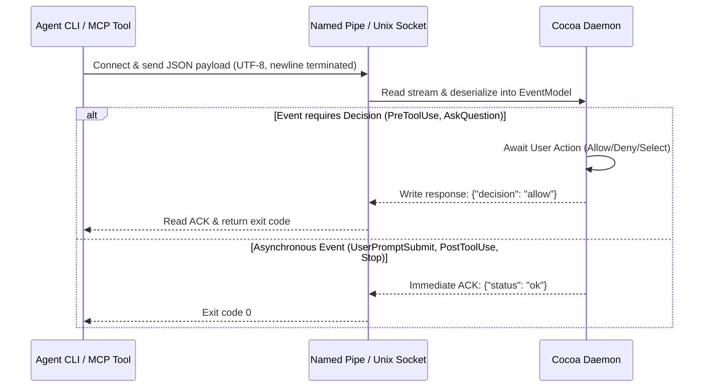
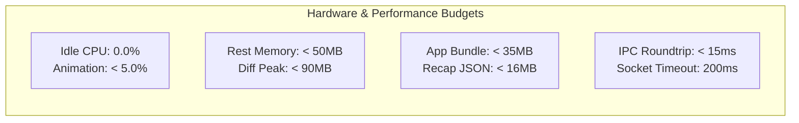
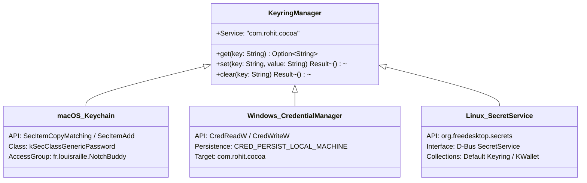
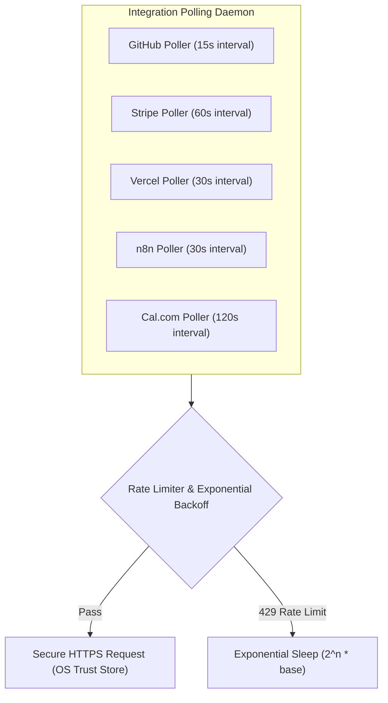

# Cocoa Notch — Technical Requirements Document (TRD)

## 1. System Engineering Specifications

This document defines the technical contracts, protocol wire formats, performance envelopes, cryptographic standards, and network integration specifications governing **Cocoa Notch**.

---

## 2. IPC Wire Protocol Specification

The Cocoa IPC daemon communicates with external CLI agents via Unix Domain Sockets (`/tmp/cocoa.sock` or `~/.local/share/cocoa/socket`) and Windows Named Pipes (`\\.\pipe\cocoa-agent`).



### 2.1 Inbound Hook Payload Schema

```json
{
  "$schema": "http://json-schema.org/draft-07/schema#",
  "title": "CocoaHookPayload",
  "type": "object",
  "required": ["hook_type", "session_id"],
  "properties": {
    "hook_type": {
      "type": "string",
      "enum": ["UserPromptSubmit", "PreToolUse", "PostToolUse", "Notification", "Stop"]
    },
    "session_id": {
      "type": "string",
      "description": "Unique UUID identifying the CLI session"
    },
    "cocoa_agent": {
      "type": "string",
      "pattern": "^[a-z0-9-]{1,24}$",
      "description": "Optional pill tag identifying the agent (e.g., 'gemini', 'antigravity', 'cursor')"
    },
    "cwd": {
      "type": "string",
      "description": "Absolute working directory path of the active project"
    },
    "tool": {
      "type": "string",
      "description": "Tool name being invoked: 'Bash', 'Edit', 'Read', 'Write', etc."
    },
    "command": {
      "type": "string",
      "description": "Raw shell command string when tool is Bash/Execute"
    },
    "file_path": {
      "type": "string",
      "description": "Target file path for file modification tools"
    },
    "diff": {
      "type": "string",
      "description": "Unified diff payload generated during file edits"
    },
    "questions": {
      "type": "array",
      "items": {
        "type": "object",
        "required": ["question", "choices"],
        "properties": {
          "question": { "type": "string" },
          "choices": { "type": "array", "items": { "type": "string" } },
          "multi_select": { "type": "boolean", "default": false }
        }
      }
    },
    "last_assistant_message": {
      "type": "string",
      "description": "Assistant conclusion text emitted at Stop"
    }
  }
}
```

### 2.2 Outbound Response Schema

```json
{
  "title": "CocoaHookResponse",
  "type": "object",
  "required": ["decision"],
  "properties": {
    "decision": {
      "type": "string",
      "enum": ["allow", "always", "deny", "terminal"]
    },
    "answers": {
      "type": "array",
      "items": { "type": "string" },
      "description": "Selected option strings for interactive question prompts"
    },
    "custom_input": {
      "type": "string",
      "description": "Freeform string when developer selected 'Other...'"
    }
  }
}
```

---

## 3. Hardware, Performance & Resource Envelopes



| Metric / Resource | Budget Target | Enforcement Mechanism |
| :--- | :--- | :--- |
| **Idle CPU Utilization** | Strictly **0.0%** | When island enters `hidden`, suspend display link timers, cancel `requestAnimationFrame`, and pause canvas rendering. |
| **Animation Frame Time** | $<16.6\text{ms}$ ($60\text{Hz}$) / $<8.3\text{ms}$ ($120\text{Hz}$) | Vector-only procedural rendering; hardware accelerated GPU canvas; no DOM reflows during spring expansions. |
| **Memory Footprint (RSS)** | $<50\text{MB}$ at rest; $<90\text{MB}$ active | Image buffers avoided; diff matrices stream-parsed and garbage collected immediately after turn ends. |
| **Binary Bundle Size** | $<35\text{MB}$ compressed | Rust release strip flags (`strip = true`, `opt-level = "z"`); zero bundled raster assets or heavy browser dependencies. |
| **Recap Log Disk Cap** | $\le 16\text{MB}$ total file size | Strict 12-week rolling window; maximum $10,000$ turns; automatic truncation when cap is reached. |
| **IPC Relay Timeout** | $\le 200\text{ms}$ hard timeout | Non-blocking socket connect; fail-open with exit code 0 if daemon is unresponsive. |

---

## 4. Cryptographic & Security Specifications

### 4.1 Local Keyring Storage
API keys and authentication tokens are stored exclusively via OS secure credential vaults:



### 4.2 Configuration File Mutation Security (`config_file.rs`)
To eliminate race conditions or accidental overwrites when managing external agent configurations (e.g. `~/.claude/settings.json`):
1. **SHA-256 Fingerprint Matching**: Prior to mutating any file, compute its cryptographic SHA-256 digest. If the digest diverges from what was rendered to the user in the preview diff, refuse the write.
2. **Atomic Backup**: Take a timestamped snapshot (`<path>.bak.<timestamp>`) and verify successful disk write.
3. **Atomic Rename**: Write new content to a temporary sibling file (`<path>.tmp.<uuid>`), execute `fsync`, and atomically rename over the original target.

### 4.3 CloudKit Field-Level Encryption
All sensitive fields synchronized to iOS via private CloudKit databases (`iCloud.fr.louisraille.Cocoa`) are encrypted client-side using Apple's CloudKit encrypted values API (`CKRecord.encryptedValues`):
- **Encrypted Fields**: Project working directories, shell commands, agent prompts, question choices, and assistant conclusions.
- **Unencrypted Fields**: Operational state (`working`, `idle`, `alert`), step counts, timestamp, and accent colors.

---

## 5. Third-Party REST API Integration Specifications



| Service | Endpoint Specification | Authentication | Polling Interval | Cache Policy |
| :--- | :--- | :--- | :--- | :--- |
| **GitHub** | `GET /user/issues?filter=subscribed`, `GET /repos/{owner}/{repo}/pulls` | Personal Access Token (`Bearer`) | $15\text{s}$ (Active) / $60\text{s}$ (Idle) | Respects `ETag` and `304 Not Modified` headers |
| **Stripe** | `GET /v1/balance`, `GET /v1/charges?limit=5` | Restricted API Key (`Bearer rk_live_...`) | $60\text{s}$ | In-memory cache with $45\text{s}$ TTL |
| **Vercel** | `GET /v6/deployments?limit=3` | Bearer Token | $30\text{s}$ | State delta comparison against last deployment ID |
| **n8n** | `GET /api/v1/executions?status=running` | Header `X-N8N-API-KEY` | $30\text{s}$ | Only polls active workflows |
| **Cal.com** | `GET /v2/bookings?status=upcoming` | API Key (`Bearer cal_...`) | $120\text{s}$ | Cached locally; recalculates countdown timer locally |
| **Resend** | `GET /emails?limit=5` | API Key (`Bearer re_...`) | $60\text{s}$ | Tracks delivery status changes |

---

## 6. Automated Test Strategy & Verification Criteria

| Test Suite / Script | Target Subsystem | Verification Goal | Execution Command |
| :--- | :--- | :--- | :--- |
| **`tests/DiffEngineTests.swift`** | Live Diff Engine | Validate Myers diff generation, line counts, and $200\text{KB}$ file cap enforcement. | `./scripts/test-diff-engine.sh` |
| **`tests/AskQuestionTests.swift`** | Multi-Question Selector | Verify single-select, multi-select, and freeform input parsing. | `./scripts/test-ask-question.sh` |
| **`tests/SafeWebURLTests.swift`** | External URL Launcher | Verify dangerous URL schemes (`javascript:`, `file:`) are blocked. | `./scripts/test-safe-links.sh` |
| **`tests/IslandAutoCloseTests.swift`** | Inactivity State Machine | Verify 60s countdown timer and 10s visual progress bar retraction. | `./scripts/test-auto-close.sh` |
| **`windows/src-tauri/src/recap.rs`**| Local Persistence Store | Verify 12-week pruning window, max turn bounds, and atomic file renames. | `cargo test --manifest-path windows/src-tauri/Cargo.toml` |
| **`design/prototype/notch-buddy.html`**| Visual Regression QA | Guarantee 1:1 pixel fidelity with original visual prototype. | Browser automated capture comparison |
